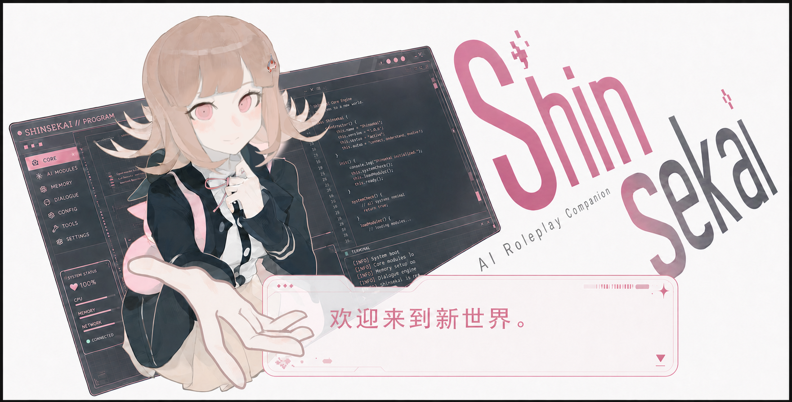
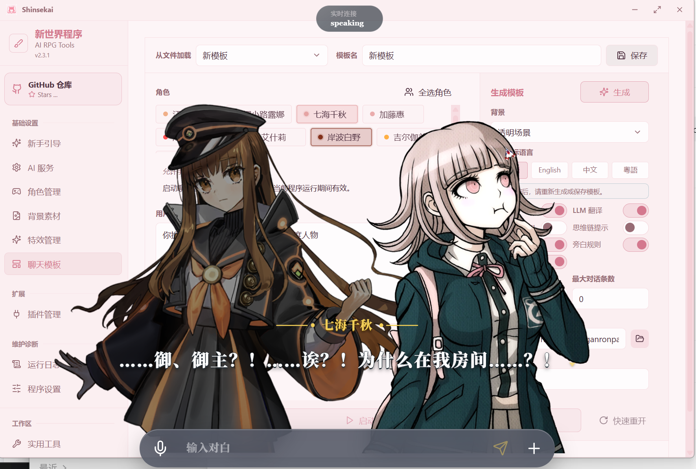

<p align="center">
  
</p>

[English](README.md) | [简体中文](docs/README_zh-CN.md)

# Shinsekai

A source-available **AI desktop companion & interactive visual-novel staging platform** for **Galgame / otome / story-driven RPG** play: let large language models drive character dialogue and full-stage performance with **multi-format avatars (static/animated sprites, MMD, Live2D)**, **outfit groups & emotion sync**, **local voice cloning, TTS & lip-sync**, **hybrid long-term memory & RAG worldbooks**, **real-time screen perception**, a **built-in desktop agent**, and **plugin / MCP extensions**—available in **English, Simplified Chinese, and Japanese**, all managed cleanly inside a Material 3 React / Tauri Settings Center.

---

## Why Shinsekai

- **Zero-Setup All-in-One Portable Bundles**: Download, extract, add your LLM API key, and launch—with an embedded Python runtime, **Qwen3-TTS 0.6B GGUF** local voice cloning (`auto` voice language), dual-stage **Sherpa-ONNX** streaming ASR, **Qwen3-VL-2B GGUF + RapidOCR** screen perception, local ONNX memory embeddings, and the official **Pi Agent** pre-installed ([Hugging Face](https://huggingface.co/RachelForster/shinsekai-portable) · [ModelScope](https://www.modelscope.cn/models/twillzxy/shinsekai-portable)).
- **Full Visual-Novel Stage & Adaptive Dialogs**: A **5-step onboarding wizard** gets LLM, voice, and characters running fast; pluggable XML/structured dialogue automatically switches **backgrounds & BGM**, pops **branching choices & live affinity/stat changes**, triggers **SFX & visual effects**, adapts to **fullscreen / expanded viewports**, and can generate **custom CGs on the fly** via **ComfyUI**.
- **Screen-Aware Companion & Desktop Pet**: **Real-time screen sharing + local RapidOCR** lets characters watch anime/videos with you, read subtitles, and react to games across 7 adaptive pacing modes (gaming, co-watching, video calls, reading, idle, etc.); includes **LAN mobile QR companion** and a draggable, edge-docking **circular mini-avatar widget** with a global input shortcut.
- **Static, Transparent Video & 3D / 2D Avatars**: Supports static images, **MP4 / WebM** transparent animated sprites, built-in **MMD (PMX)** models with auto breathing, breeze, gaze, and VPD / VMD motions, and experimental **Live2D** support—plus **lip-sync & speaking blinks** and **outfit groups with story-driven auto-switching**.
- **Full Expression Sets & Matting Studio**: Built-in LLM prompt planning, T2I generation, optional **MiniMax H3** image-to-video (generate expressive sprite sets from a single reference, 22-frame directional transitions, and transparent animated sprites), and **ToonOut / ISNet** matting.
- **One-Sentence Character Creation & AI Branching Story Canvas**: Ask the built-in **desktop agent (Pi runtime)** to research info, draft character bios, generate/import sprites, and prepare voices end-to-end; use **Story Mode** to turn a premise into an editable **branching node canvas** with **multi-character ensemble scenes**.
- **Replay, Video Recording & Offline Playable VN Export**: Select any range of chat history to **copy text**, capture **long PNG screenshots**, **replay lines on the stage** (with optional voice completion), **record MP4 / WebM videos** with audio/BGM/SFX, or **export standalone offline playable VN packages**.
- **Everyday Assistant & System Tray Reminders**: The desktop agent can search online, read/write local files, organize folders, and save notes into your knowledge base; desktop builds support **system tray residency, OS autostart, and scheduled character voice reminders**.
- **Structured Long-Term Memory, Worldbooks & Relationships**: Powered by a local **SQLite + FTS5 + ONNX** hybrid engine (zero PyTorch required) with **Ebbinghaus retention decay**, **per-save memory isolation**, a renameable built-in **self-persona**, **character relationship graphs**, and a dedicated **knowledge base (RAG)** for worldbooks and TXT lore imports.
- **Themes, Tri-Lingual UI & Plugin Ecosystem**: Full **English / Chinese / Japanese** UI & prompt templates, **5 built-in Galgame chat themes** (plus a **visual theme customizer**), **Qwen3-TTS / GPT-SoVITS / Genie TTS / CosyVoice**, **Sherpa-ONNX / Vosk / Whisper**, **plugin SDK**, and **MCP (SSE / stdio)**, with all local-first data stored under `data/`.

---

## Preview



[](https://www.bilibili.com/video/BV1V4H7z5Ez7/)
[](https://www.bilibili.com/video/BV1Hp4y1c7TU/?share_source=copy_web&vd_source=4641a345db4563ba087d0ed0ba8bdf85)

**Video Walkthrough (Chinese UI/Audio):** [API setup and importing a character pack](https://www.bilibili.com/video/BV1V4H7z5Ez7/)

---

## Feature Snapshot

| Area | What You Get |
|------|--------------|
| **Onboarding, i18n & Desktop Tray** | **5-step guided setup** (API / plugins / characters / backgrounds); full **EN / ZH / JA** UI & prompt templates; Material 3 Settings Center with **system tray minimization**, OS autostart, and **scheduled character voice reminders**. |
| **Characters, Relations & Self-Persona** | Create / import-export character packs (`.char`), AI-assisted bios & translation, or one-sentence agent creation; visual **character relationship graphs** with affinity (`-10` to `+10`) injected into context; built-in renameable **self-persona** (tracked by immutable ID). |
| **Sprites, Outfits & Dynamic Models** | Images, MP4 / WebM transparent video, **MMD (PMX + VPD/VMD)**, and experimental **Live2D**; unified full / half / close-up framing; **outfit groups** (smart auto-grouping, manual switch/lock, story auto-switching); **lip-sync & speaking blinks**; smooth crossfade fallback. |
| **AI Sprite Studio** | Centered workspace: LLM prompt & tag planning, reference-preserving T2I (multi-expression sets from one image), optional **MiniMax H3** frame picking / transparent animation / 22-frame directional transitions (with chat-history recommendations), and ToonOut / ISNet matting. |
| **VN Stage, Replay & Playable Export** | Pluggable XML dialogue with auto-switching **backgrounds, BGM & SFX/visual effects**, **branching choices & affinity/stat updates**, fullscreen/wide viewport dialog adaptation, and live **ComfyUI CG generation**; single-timeline compaction & 4-in-1 revert; **stage replay**, **PNG screenshot**, **MP4/WebM recording**, **offline playable VN package export**, **mini-avatar widget**, and **LAN mobile QR access**. |
| **AI Story & Node Canvas** | Turn a premise and cast into a playable story with a visual **branching node graph** (drag-and-drop editing + LLM-assisted graph revisions), **multi-character scenes**, deterministic path validation, and versioned saves. |
| **Long-Term Memory & Worldbooks** | Local **SQLite + FTS5 + ONNX** hybrid engine (zero PyTorch memory dependency); canon facts & Ebbinghaus retention decay, 3 save-isolation modes, and TXT/JSON history extraction; separate **knowledge manager** for worldbook/TXT imports with per-character bindings. |
| **Screen Perception & Desktop Agent** | **Screen sharing + local RapidOCR** (subtitles / full screen / region) powered by `Qwen3-VL-2B GGUF + llama.cpp` and shared-audio detection across 7 adaptive scenes; **desktop agent (Pi runtime)** supporting web lookup, local file/folder tools, character setup, diagnostics, and plugin skills. |
| **Voice (TTS / ASR)** | **TTS**: Built-in **Qwen3-TTS 0.6B GGUF** local voice cloning (`auto` voice language), **GPT-SoVITS**, **Genie TTS**, **CosyVoice**, voice archiving, per-sprite line audio fallback, and `characters.voice.prepare` automated voice pipeline; **ASR**: default dual-stage **Sherpa-ONNX** streaming (Zipformer + SenseVoiceSmall), **Vosk**, **Whisper** with F8 hold-to-talk. |
| **Themes, Plugins & MCP** | **5 built-in Galgame themes** and **visual theme customizer**; **ComfyUI** & T2I plugins; `data/config/plugins.yaml` + **Plugin Manager** ([Shinsekai-Plugin-Registry](https://github.com/RachelForster/Shinsekai-Plugin-Registry)); **MCP (SSE / stdio)** external tool integration. |

---

## Quick Start (~5 Minutes)

### Option A — All-in-One Portable Bundles (Recommended for Zero Setup)

Want to try Shinsekai immediately without installing Python, Node, or downloading local models one by one? Grab the multi-platform **Portable Bundle**:

- **Hugging Face (Global)**: [RachelForster/shinsekai-portable](https://huggingface.co/RachelForster/shinsekai-portable)
- **ModelScope (China Mirror)**: [twillzxy/shinsekai-portable](https://www.modelscope.cn/models/twillzxy/shinsekai-portable)

**What is pre-bundled out of the box:**

- **Self-contained Python runtime** (`runtime/`, no local Python install needed) + default **ISNet** sprite matting
- **Local voice cloning**: `Qwen3-TTS-12Hz-0.6B-Base` (`Q8_0` GGUF) powered by bundled `llama.cpp`, enabled by default with `auto` voice language (automatically follows each character's reference audio language)
- **Local streaming speech recognition**: dual-stage **Sherpa-ONNX** (Zipformer real-time streaming + SenseVoiceSmall ZH/EN/JA/YUE/KO)
- **Local screen perception**: `Qwen3-VL-2B-Instruct` (`Q4_K_M` GGUF) + `llama.cpp` + **RapidOCR** local text recognition (enabled by default, zero PyTorch required)
- **Local long-term memory**: ONNX embedding model (`data/cache/huggingface/`)
- **Desktop agent runtime**: pre-installed official **Pi Agent** (`data/agent/runtimes/pi/`)
- **Clean portable `data/`**: marked with `.shinsekai-portable` so all configs, saves, memories, and models stay self-contained inside the extracted folder without touching other installations

**Supported targets & how to run:**

| Platform | Archive | How to Launch | Notes |
|---|---|---|---|
| `windows-x64` | `.zip` | Double-click `shinsekai.exe` | Extract to an ASCII/English path such as `D:\Shinsekai` |
| `windows-arm64` | `.zip` | Double-click `shinsekai.exe` | Omits `Sherpa-ONNX` and `RapidOCR` due to upstream Windows ARM64 wheel availability |
| `macos-arm64` | `.tar.gz` | Open `Shinsekai.app` | Contains `Shinsekai.app` + sibling `data/`; if Gatekeeper says the app is damaged/unverified, run `xattr -cr Shinsekai.app` in Terminal first |
| `linux-x64` | `.tar.gz` | Run `./shinsekai` | Run `chmod +x shinsekai` if needed |
| `linux-arm64` | `.tar.gz` | Run `./shinsekai` | Run `chmod +x shinsekai` if needed |

> After extracting to an English/ASCII directory and launching, simply enter your LLM API key (e.g. OpenAI, DeepSeek, Claude, Gemini) in **API Settings** and you can immediately chat, use local voice cloning, screen perception, and the Pi Agent assistant.

---

### Option B — Standard Installers

Download the desktop installer or archive for your OS from [GitHub Releases](https://github.com/RachelForster/Shinsekai/releases) (or use the auto-matched buttons on the [Project Homepage](https://rachelforster.github.io/Shinsekai/)).

> **macOS first launch**: if macOS reports an unverified developer, right-click (or Ctrl-click) the app → **Open**, then confirm **Open**, or allow it in **System Settings → Privacy & Security**.

---

### Option C — From Source

**1. Clone the repository:**

```bash
git clone https://github.com/RachelForster/Shinsekai
cd Shinsekai
```

**2. Install dependencies** (Python 3.10 recommended):

Using the project Conda definition:

```bash
conda env create -f environment.yml
conda activate shinsekai
```

Or install manually into Python 3.10:

```bash
conda create -n shinsekai python=3.10
conda activate shinsekai
pip install -r requirements.txt
```

Or use the platform setup scripts:

| Platform | Install | Launch (React Web Settings Center) |
|----------|---------|------------------------------------|
| Windows | Double-click `scripts\install.bat` | Double-click `scripts\start.bat` (or `scripts\start-tauri.bat`) |
| macOS | Double-click `scripts/install.command` | Double-click `scripts/start.command` |
| Linux | `./scripts/install-linux.sh` | `./scripts/start.sh` |

On Linux, `./scripts/install-linux.sh` installs into the currently active non-`base` Python 3.10 conda environment if present, or prefers `uv` to create `.venv` (falling back to system `python3.10`).

**3. Build the React frontend & launch:**

```bash
cd frontend
pnpm install
pnpm build
cd ..
```

`frontend/dist` is not committed to source control. Run `pnpm build` once before using `scripts/start.*` (or pass `--build-if-missing` / `--build-if-stale` when invoking the start script). The retired Qt settings and chat windows are no longer available.

**For Tauri desktop development or local packaging:**

```bash
cd frontend
pnpm install
pnpm tauri:dev
```

`pnpm tauri:dev` runs `pnpm build` and `pnpm prepare:tauri-resources` before launching `tauri dev`. To build a desktop bundle locally:

```bash
cd frontend
pnpm install
pnpm build
pnpm prepare:tauri-resources
pnpm tauri build
```

Release updater builds require `TAURI_SIGNING_PRIVATE_KEY` (and `TAURI_SIGNING_PRIVATE_KEY_PASSWORD` if encrypted). Before a release, update the root `VERSION` file and run `cd frontend && pnpm sync:version` to sync `package.json`, Cargo manifests, and `runtime_manifest.json`.

---

### First Conversation

1. Open **API Settings**, configure your LLM provider, model ID, API key, and Base URL (e.g. DeepSeek, OpenAI, Claude, Gemini, or any OpenAI-compatible endpoint), test connectivity, and save.
2. Under **Character Management**, import a character pack (example: [nanami.char](https://github.com/RachelForster/Shinsekai/releases/download/v1.0.4/nanami.char); more community packs at [Community Resources](https://rachelforster.github.io/Shinsekai/resources.html)), or open the **Assistant** in the bottom-left sidebar and describe a character to create one automatically.
3. Open **Chat Templates**, pick your characters (plus optional self-persona / player character and initial outfits), and generate a template.
4. Click **Start Chat** to enter the stage and experience live dialogue, sprite/model motion, and voiced performance.

### Optional: Extra Voice Engines

Portable bundles already ship with **Qwen3-TTS 0.6B GGUF** local voice cloning enabled (`auto` voice language). If you want higher-expressiveness or dedicated voice backends, open **API Settings → Voice** to one-click download **GPT-SoVITS** or lightweight **Genie TTS** (or self-host [GPT-SoVITS](https://github.com/RVC-Boss/GPT-SoVITS)), or use the desktop assistant's automated `characters.voice.prepare` workflow.

---

## Configure LLM (Quick Reference)

1. Navigate to **API Settings**.
2. Choose a provider and fill in **Model ID**, **API Key**, and **Base URL** (default URLs are auto-filled for built-in providers).
3. Save and return to chat; **Vision** defaults to your active LLM provider and can also be overridden independently.

---

## Plugin System

Register plugins in **`data/config/plugins.yaml`** with source under **`plugins/<package>/`**. The host merges **LLM / TTS / ASR / T2I** adapters, **tools**, and UI contributions across **Settings**, **Tools**, **Chat Workspace**, and **Chat Stage**.

- **GUI**: Settings → **Plugins** — enable/disable, discover & install from the registry, and `pip install` plugin dependencies using the active interpreter.
- **Plugin Registry**: [Shinsekai-Plugin-Registry](https://github.com/RachelForster/Shinsekai-Plugin-Registry)
- **Scaffold**: `python -m sdk.cli create --package your_plugin_name`
- **Developer Guide**: [docs/PLUGIN_DEVELOPER_GUIDE.md](docs/PLUGIN_DEVELOPER_GUIDE.md)

Restart the app after editing the plugin manifest to reload plugins.

---

## MCP (Model Context Protocol)

Connect [MCP](https://modelcontextprotocol.io/) servers directly to the **in-process LLM tool list** over **SSE** or **stdio**:

1. Install: `pip install mcp`
2. Configure **`data/config/mcp.yaml`**, or edit visually in Settings → **Plugins** → **MCP**.
3. Click **Save & Apply** to reconnect servers and register remote tools (optionally add a tool name **prefix** per server to avoid collisions).

Independent of the plugin system: wire external capabilities through YAML alone with no `PluginBase` boilerplate.

---

## Docs & Links

| Topic | Link |
|-------|------|
| **Project Homepage (GitHub Pages)** | [rachelforster.github.io/Shinsekai](https://rachelforster.github.io/Shinsekai/) |
| **Portable Bundles (Global / China)** | [Hugging Face](https://huggingface.co/RachelForster/shinsekai-portable) · [ModelScope](https://www.modelscope.cn/models/twillzxy/shinsekai-portable) |
| **简体中文 README** | [docs/README_zh-CN.md](docs/README_zh-CN.md) |
| **Changelog & Latest Release Notes** | [CHANGELOG.md](CHANGELOG.md) · [2.7.0 Release notes](docs/releases/2.7.0.md) |
| **Plugin Developer Guide** | [docs/PLUGIN_DEVELOPER_GUIDE.md](docs/PLUGIN_DEVELOPER_GUIDE.md) |
| **GUI User Guide (Chinese)** | [docs/GUI_USER_GUIDE_zh-CN.md](docs/GUI_USER_GUIDE_zh-CN.md) |
| **AI Sprite & MiniMax H3 Guide (Chinese)** | [docs/CHARACTER_SPRITE_GENERATION_zh-CN.md](docs/CHARACTER_SPRITE_GENERATION_zh-CN.md) |
| **ComfyUI Setup Guide (Chinese)** | [docs/COMFYUI_SETUP_zh-CN.md](docs/COMFYUI_SETUP_zh-CN.md) |
| **MMD & Live2D Guides (Chinese)** | [docs/MMD_INTEGRATION_zh-CN.md](docs/MMD_INTEGRATION_zh-CN.md) · [docs/LIVE2D_INTEGRATION_zh-CN.md](docs/LIVE2D_INTEGRATION_zh-CN.md) |
| **Chat Theme Guide (Chinese)** | [docs/CHAT_UI_THEME_GUIDE_zh-CN.md](docs/CHAT_UI_THEME_GUIDE_zh-CN.md) |
| **Replay & Export Guide (Chinese)** | [docs/CHAT_REPLAY_CUJ_zh-CN.md](docs/CHAT_REPLAY_CUJ_zh-CN.md) |
| **Agent, Tray & Story Mode Guides (Chinese)** | [docs/AGENT_APP_INTEGRATION_zh-CN.md](docs/AGENT_APP_INTEGRATION_zh-CN.md) · [docs/DESKTOP_TRAY_zh-CN.md](docs/DESKTOP_TRAY_zh-CN.md) · [docs/STORY_MODE_WORKSPACE_zh-CN.md](docs/STORY_MODE_WORKSPACE_zh-CN.md) |
| **Repository** | [github.com/RachelForster/Shinsekai](https://github.com/RachelForster/Shinsekai) |

---

## Community

- GitHub Issues and Pull Requests are welcome!
- Chinese Developer QQ Group: `928985460`
- When redistributing character or voice packs, please respect each original creator's license.

---

## License Notice

Shinsekai is a source-available project licensed under the **PolyForm Strict License 1.0.0** with **Shinsekai Additional Permissions and Contribution Terms**. You may inspect, build, and modify the source code locally for personal noncommercial use and study, and maintain GitHub forks for learning, discussion, and submitting pull requests. Commercial use and redistribution (including modified copies, release builds, installers, portable bundles, standalone mirrors, or app/game store distribution) are not permitted without prior written permission. See [LICENSE](LICENSE).
