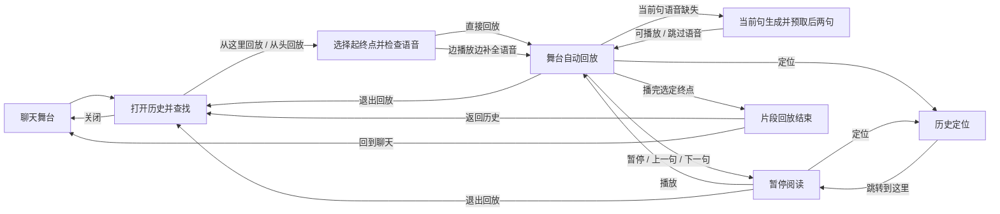

# 聊天历史回放 CUJ

状态：已接入原有消息展示队列与主舞台；本文记录交互与验收契约。更新：2026-11-07。

## 1. 用户目标与功能定位

> 我在聊天历史里选出一段喜欢的剧情，想重新看一遍角色对白和演出；缺少语音时可以补生成，看完后还能接着原来的聊天。

功能名为「剧情回放」，入口放在聊天舞台现有的「对话历史记录」弹窗。普通聊天与剧本聊天使用同一条操作路径。

回放按保存的顺序展示用户发言、角色对白、旁白、当时的选择及可用演出资源。它是阅读历史的方式，不推进当前剧情，不重新请求对话模型，也不重新执行工具。只有用户明确选择补全语音时，才使用保存的台词调用当前配置的 TTS。

| 现有或新增操作 | 用户目的 | 结果 |
| --- | --- | --- |
| 播放语音 | 再听这一句 | 仅播放这一句已有的语音，保留历史弹窗 |
| 从这里回放 | 重温这一段 | 将该句设为起点，打开历史底部的范围与语音准备栏 |
| 创建分支 | 尝试另一条发展 | 沿用现有分支操作 |
| 回溯到上一条 | 修改先前的聊天 | 沿用现有确认流程及移除后续对话的语义 |

现有语音按钮的中文文案为「重播」，建议改为「播放语音」，避免与剧情回放混淆。回放入口不依赖用户开启语音存档。

## 2. 入口与范围

- 历史弹窗顶部增加「从头回放」。每条可阅读记录增加「从这里回放」。入口始终可见，不仅在悬停时显示。两者均在原弹窗底部展开准备栏，不再叠加设置弹窗。
- 沿用已有搜索。搜索用于找到起点；回放仍沿原始时间顺序播放后续内容，不只播放搜索命中的条目。
- 一次回放限定于准备时的会话、当前分支与历史快照；默认终点是该快照最后一条已完成记录，用户可以指定更早的终点。后来新增的消息不自动追加到片段。
- 有分支时显示当前分支名称；单分支会话不额外增加选择器。切换其他分支继续沿用已有分支入口，首版不新增跨分支回放。
- 顶部「从头回放」默认选中本分支全部可用记录，随后可修改终点。只渲染了最近 120 条或处于搜索状态，都不改变默认范围。
- 空历史中入口禁用并显示「还没有可回放的内容」。正在生成回复、执行工具、录音或处理待发送消息时，可浏览历史，暂不可开始回放，并显示原因；状态恢复后由用户再次点击。

首版聚焦聊天舞台里的历史弹窗。聊天列表直接打开独立回放器，可作为后续入口扩展。

### 2.1 起点与终点

1. 点击「从这里回放」后，将该条标为起点 A；准备栏显示起止记录编号、两端短预览及片段总条数。
2. 默认终点 B 为快照末条；点击「更改终点」后，在列表选择「到这里结束」。搜索仍可用，起点不因搜索结果变化而丢失。
3. 起点和终点都包含在片段内。允许 A = B，作为单句回放；B 必须不早于 A，且属于同一分支，非法候选不可选择并说明原因。
4. 「更改起点」沿用同样的点选方式。若新起点晚于旧终点，则明确把终点重置为快照末条，并更新可见摘要，不静默交换起止顺序。
5. 搜索筛选不改变区间成员；A 到 B 之间未命中搜索的记录也会回放。两端未在屏幕内时，准备栏的预览仍可定位它们。
6. 语音检查、补生成、预加载和播放均限定于这个区间。恢复起点场景所需的早期状态可以读取，但不播放早期声音，也不为区间外台词生成音频。
7. 播放到 B 时，等待末句文字和语音完成后结束，停止回放环境音，不越界继续、不自动循环。「重新播放」重播同一 A–B 区间。

范围准备阶段发生分支切换、回溯或记录删除时，必须重新核对快照及起止身份；无法匹配时回到范围选择，不按重排后的显示编号猜测位置。

## 3. 主 CUJ：找到片段，重温演出，回到聊天

示例场景：用户想重看角色说「明天还在这里见吧」前后的一段剧情。示例文本仅用于说明交互。

| 步骤 | 用户行为 | 系统反馈与可见结果 |
| --- | --- | --- |
| 1. 找到记录 | 打开聊天历史，搜索「明天」 | 保留现有历史样式，展示匹配的角色、对白及记录位置 |
| 2. 选择范围 | 点击该句的「从这里回放」，按需点选「到这里结束」 | 底部显示起点、终点、片段条数及语音检查结果；终点默认末条 |
| 3. 选择语音并开始 | 点击「直接回放」，或「边播放边补全语音」 | 历史消息重新加入 presentation 队列，使用原舞台逐句呈现；顶部状态显示 `replaying`，输入框保留并禁用。直接回放使用已有音频；补全模式优先生成当前句并预取后两句，结果自动保存 |
| 4. 控制节奏 | 暂停、继续、上一句、下一句 | 白字、语音与自动推进遵循同一播放状态；手动跳转后停在目标句，方便阅读 |
| 5. 调整位置 | 点击「定位」，在选定片段内搜索另一句 | 自动暂停，历史标出当前回放位置；点击「跳转到这里」后回到舞台，暂停在目标句 |
| 6. 结束观看 | 播放到选定终点，或点击「退出回放」 | 播完终点句后显示「片段回放结束」，提供「重新播放」「返回历史」「回到聊天」；主动退出则返回进入前的历史位置 |
| 7. 继续聊天 | 关闭历史或点击「回到聊天」 | 恢复当前会话的正常舞台与输入草稿，可继续原来的聊天 |

成功标准：默认范围只需选择起点并点击「直接回放」；希望完整配音或指定终点的用户，在同一个准备栏即可完成。用户始终知道片段范围、当前播放位置，以及如何回到聊天。



## 4. 界面结构与播放规则

保持现有半透明历史浮层和舞台皮肤。「从这里回放」使用图标加文字，与播放 / 保存语音或分支 / 回溯按钮放在同一个操作行。回放继续使用原舞台，控制条替换原对白工具栏，按实际高度与对白、选项及输入框留出间距。输入框与草稿可见，发送、附件及语音输入禁用；顶部状态条显示 `replaying`。回放状态与退出入口始终可见，不随工具栏自动隐藏。

历史弹窗示意：

```text
对话历史记录                  [从头回放] [复制] [更多] [关闭]
搜索对白或角色……                         语音存档：开 / 关

角色名 · 第 24 条
明天还在这里见吧。
[从这里回放] [播放语音] [保存语音]

你 · 第 25 条
好，明天见。
[从这里回放] [创建分支] [回溯到上一条]
```

「清空历史」可收入顶部「更多」，避免新增主操作后工具栏拥挤，并保留原有确认流程。语音相关操作只在有相应语音时显示。

选择范围后，历史底部固定显示准备栏；下例计数仅为交互示意，实际由该片段资源检查得出：

```text
回放范围：第 24 条 → 第 40 条 · 共 17 条
起点：明天还在这里见吧。 [更改起点]
终点：那就说定了。       [更改终点]
角色对白 12 句：已有语音 8 句，缺失 4 句
补生成将使用当前角色配音，并保存到本次聊天供下次回放使用。
[直接回放] [边播放边补全语音] [取消]
```

只有存在可生成的缺失台词时，才出现补全操作；未配置可用 TTS 或角色参考音频时明确提示对应句子将显示文字。配音可在现有 API 与角色设置中配置，直接回放始终可用。

回放控制条示意：

```text
回放中 · 当前分支 · 片段第 1 / 17 条（历史第 24–40 条）
[上一句] [暂停 / 播放] [下一句] [定位] [退出回放]
```

- **默认自动播放**：有语音时等待本句语音及文字展示完成，再留短暂停顿；无语音时根据文字长度提供阅读时间。无语音时长规则作为实现阶段可调参数，不按原聊天时的思考、网络等待时间播放。
- **暂停 / 继续**：暂停文字推进、语音及下一句计时，继续时从暂停处恢复。BGM 可继续作为环境音；首版不承诺动态模型、循环视频和背景音乐逐帧暂停。
- **上一句 / 下一句**：停止当前语音及计时，显示目标句完整文字和对应场景，保持暂停；再次播放时从该句开始。不能越过所选起点或终点。
- **定位**：仅展示和搜索本片段内的历史，高亮当前位置；此时逐条操作为「跳转到这里」，暂不提供分支、回溯或清空操作。关闭定位弹窗后仍暂停，不突然恢复出声。若要改变范围，返回历史准备栏重新选择。
- **进度**：以「片段第 N / 总条数」表示，并提供原历史起止位置；仅统计区间内可阅读内容，不把场景、BGM 等内部指令算作一句。首版不显示无法准确估算的总秒数，也不提供按秒拖动的时间轴。
- **快捷键**：回放模式中，空格播放 / 暂停，左右方向键上一句 / 下一句；Esc 优先关闭定位弹窗，再退出回放。输入框或其他可交互控件持有焦点时，不拦截其原生按键。普通聊天的快捷键保持原有语义。
- **窄窗口**：控制条分行，播放和退出保持可见；每条历史上的回放入口仍可直接点击。按钮提供清晰名称及焦点状态。

返回历史时恢复原搜索词和滚动位置，并将焦点还给触发按钮。定位用的搜索状态与最初进入回放的历史状态分别保存。

## 5. 回放内容与真实性

| 内容 | 首版行为 |
| --- | --- |
| 用户发言、角色对白、旁白 | 按保存顺序展示；用户发言也占一个阅读位置，不重新提交 |
| 已有语音 | 优先复用已存档音频、可核实的原绑定音频或此前补生成的有效音频，按本句片段顺序播放 |
| 缺失语音 | 默认只展示文字；用户在准备栏明确选择后，才补生成选定区间内可配音的台词并保存 |
| 背景、立绘、表情、CG、BGM | 优先使用与该句绑定的已保存演出结果。变化发生在两句之间时，在下一句开始前应用 |
| 历史选项 | 展示当时选项；已有可靠选择记录时标出「当时的选择」，点击不触发新剧情。没有选择记录时不推断 |
| 选项后没有后续内容 | 展示完已有记录后结束回放；用户回到正常聊天后再作选择 |
| 剧本进度、数值变化 | 已记录的可见信息可以只读展示；不重新计算或写入剧情状态 |
| 工具结果、插件内容 | 只展示已保存且可静态呈现的结果；不运行历史工具、脚本或交互动作 |

任意句作为起点时，必须先恢复截至该句的场景状态；仅播放该句附近的变化会漏掉更早设置的背景和 BGM。缺少可靠的历史画面时，使用中性舞台显示文字，不把当前聊天的立绘冒充当时的画面。

旧记录允许基础回放：文字为必选，已有音频为可选。在准备栏以轻提示说明「这段历史未保存完整演出，将播放文字与可用语音」；用户仍可单独选择补全语音。部分画面资源缺失时，仅省略对应资源并继续播放，不逐句弹窗。

### 5.1 缺失语音的处理

「没有开启语音存档」不必然意味着音频完全不可用。先检查与历史条目有可靠关联的原音频及已保存的补生成音频；文件仍存在且完整时直接复用。不能拿角色当前绑定的另一句录音或只按相同文本匹配的其他音频冒充原声。

缺失时提供两条清晰路径：

- **直接回放（默认）**：有声音的句子正常播放，缺失句保留文字和阅读停留；不调用 TTS。
- **边播放边补全语音**：使用保存的台词和当前角色的 TTS 配置，只合成所选区间中缺失且可配音的句子；不改写台词，不请求对话模型。准备栏可查看实际使用的角色配音；用户发言、选项和内部指令默认不配音，旁白仅在有明确旁白配音配置时纳入。

补生成属于重新配音。声线、语气、语速未必与当时相同；每条音频记录「原存档 / 原资源 / 补生成」来源，补生成时记录所用配音配置版本，界面可以查看。补全不覆盖可用的原存档；首版不提供批量替换原声。

生成流程：

1. 开始前显示该区间已有语音及可补生成句数，未配置配音的台词明确以文字展示。
2. 点击「边播放边补全语音」后冻结范围、台词与配音配置，立即进入舞台。当前句优先，串行预取后面两句；不等待整个片段生成完。
3. 已有语音直接播放；当前句缺失时先显示文字并提示「正在生成本句语音」，生成完成后播放。用户可以「跳过本句语音」继续阅读。
4. 暂停时暂停文字、声音及推进计时，当前在途生成可以完成，但不再派发下一项。继续时复用已生成音频。
5. 跳转后取消尚未派发的旧预取目标，按新位置重新安排；在途生成完成只更新对应条目的资源，不自动播出已离开的句子。
6. 某句生成失败时停留在该句，提供「重试语音」和「跳过本句语音」。其他已成功结果保留，不自动无限重试。
7. 退出后不再派发请求，并尽力取消在途请求。已完成音频可保存复用，迟到结果不能开始播放；会话已替换或存档已删除时不得写回复活旧记录。

生成结果作为本聊天的回放音频单独保存，下次直接复用；不自动开启后续聊天的「语音存档」开关。保存采用会话 / 分支条目身份、台词校验和与配音配置指纹关联并去重，不能只按列表编号关联。旧历史使用固定快照身份和明确位置关联，避免相同台词串音。配音配置后来改变时，已保存的补生成音频仍可使用，并显示其来源；不因此自动重新生成。删除聊天时清理其派生音频，遵守共享资源引用关系。

## 6. 状态隔离、退出与异常

回放的播放位置和当前聊天的剧情位置是两个独立状态。回放操作不删除后续对话、不切换活动分支、不写入长期记忆、不生成新消息。

- **进入时**：冻结可阅读的历史范围，保留输入草稿与附件，停止当前客户端的单句重播，并暂停普通舞台的自动推进和声音；仍未完成的实际回复须先结束。
- **回放中**：输入框禁用，历史选项使用原选项组件只读显示；可靠记录中的已选项高亮，并带有勾选图标和「当时的选择」。复用原语音完成回执，只推进带回放标记的队列项，不重新提交用户消息或历史选择。
- **多端同步**：回放由当前会话的 presentation 队列处理，其他连接可同步看到回放状态。服务端在回放期间拒绝发送、选项提交、回溯和切换分支等会改变剧情的命令；刷新页面可恢复同一片段的控制。退出恢复进入时的实时舞台，输入草稿和附件留在客户端。
- **退出时**：取消回放计时、音频和待加载请求，迟到的加载结果不能重新出声或覆盖舞台。恢复草稿与正常会话显示；普通舞台停在可继续的位置，不自动补播全部历史声音。
- **加载失败**：保留历史列表与原来的定位，提示「回放加载失败」，提供重试。准备中支持取消，连续点击只启动一次回放。
- **语音或画面文件失效**：保留文字、继续播放，并以可收起的提示说明资源缺失；不自动联网寻找替代品。
- **补生成的隔离**：只有用户点击补全动作才能发起 TTS 和保存派生音频；这不修改消息、分支、剧本状态或长期记忆。生成失败、取消或退出后的回调不能触发正常聊天的语音完成信号。
- **回放快照之外的数据变化**：快照读取完成后不随实时历史重排；尚未取得的记录失效时停止并提供返回历史。会话被关闭或替换后，返回当前有效会话或聊天列表，不恢复旧会话。

状态转换为「历史 → 范围与语音准备 → 播放 / 暂停与滚动补生成 → 已结束 → 历史或聊天」。补生成失败停留在当前句，提供重试与跳过；取消准备、退出播放、关闭窗口都执行回放清理逻辑。

## 7. 当前代码提供的基础与需要补齐的能力

已核对的基础：

- `frontend/src/features/chat-stage/components/HistoryDialog.tsx`：已有搜索、分批展示、单句语音、分支和回溯入口，可以承载回放起点。
- `frontend/src/shared/platform/types.ts` 的 `ChatHistoryEntry`：目前主要包含文字、角色类型、时间、可选 `voiceId` 与回溯索引，基础接口保持轻量；回放接口另行关联已保存的舞台检查点。
- `frontend/src/features/chat-stage/ChatStagePage.tsx`：已有历史单句音频播放及停止逻辑，可复用音频资源访问方式。
- `application/chat/history/state.py`：展示层 ID 形如 `history-24`；新增对白身份用于关联演出，旧记录按会话、分支与历史前缀计算身份，不将列表编号当作持久身份。
- `core/chat_history/identity.py`：已有回合与对白身份基础，可用于新记录的演出关联；旧历史缺少可靠身份时应按版本化快照定位，不能只按台词文本匹配。
- `application/chat/dialog_media/replay.py` 与 `application/chat/presentation/restore.py`：用于按当前资源策略恢复最近的演出，不能直接视作完整的历史连续回放。
- `core/story/replay.py`：用于重建权威剧本状态，不应当作面向用户的回放播放器调用。

首版实现包含四部分：

1. **只读回放数据**：返回会话、分支、历史版本、稳定条目身份、可读顺序、可用媒体与能力信息；验证包含两端的 A–B 区间。回放范围独立于历史弹窗的筛选和渲染批次，播放器和补生成任务均不得越界。
2. **演出留档**：为新记录保存实际解析出的舞台变化和必要的起始快照，关联稳定对白身份及资源引用。记录明确的停止 / 清除状态；不能只保存原始媒体指令后按今天的资源配置重新计算。语音仍遵守用户的语音存档设置。资源引用失效时诚实降级；长期保留资源副本不作为首版默认行为。
3. **复用展示队列**：将选定历史转换为带回放身份的 `PresentationMessage`，交给原 `PresentationWorker` 消费；通过既有的对白事件、打字机、语音播放器和完成回执呈现。回放适配层只恢复已保存的画面，不经过 LLM、历史写入、插件处理器或工具执行链。暂停、跳转与退出以回放身份及队列版本隔离，过期队列项和迟到音频无法覆盖新位置。
4. **可选语音补全任务**：复用现有 TTS 适配器和媒体访问方式，由服务端按队列当前位置滚动补全当前句及后两句；单独管理范围、配音配置快照、来源标记、保存、去重、取消与失败重试。只有明确选择补全后才启动，不重新生成对话内容。

## 8. 首版边界与验收 CUJ

首版包含：历史双入口、可选起止点的区间回放、范围与语音准备栏、可选的缺失语音补全与保存、暂停 / 继续、前后切句、片段内定位、已有语音、已留档的基础舞台演出、旧记录降级、可靠退出。新演出留档与旧记录兼容属于同一次能力交付，不能只加按钮就宣称完整演出已支持。

后续再考虑：倍速、收藏片段、跨次播放进度、导出视频、从回放位置创建分支、聊天列表独立回放入口，以及动态模型 / 视频 / 插件特效的精确重现。

| 验收场景 | 通过标准 |
| --- | --- |
| 搜索一句并选择终点 | 包含两端，按原序播放整段；不会只播放搜索结果 |
| 单句片段、逆序终点、跨分支候选 | 单句可播；无效范围无法开始，并说明原因 |
| 到达终点与重新播放 | 末句文字及语音完成后结束，不播放或补生成下一句；重新播放同一区间 |
| 历史超过 120 条并从头回放 | 从本分支第一条开始，包含尚未渲染的旧记录 |
| 从中间开始且此前有背景切换 | 第一帧就使用该句对应的场景；不出现当前聊天画面串入 |
| 有 / 无语音混合并直接回放 | 有音频等待播放结束，无音频可读后继续；不请求对话模型、TTS 或历史工具 |
| 明确选择补全语音 | 只为区间内可配音的缺失句调用 TTS；已存音频不重生成，未配置角色不冒用其他声线 |
| 补全失败、取消、重试及下次回放 | 已成功音频保留并复用，重试只补失败项；迟到结果不自动播放，来源标记正确 |
| 暂停、快速前后跳转、退出 | 无重叠声音、无多余自动跳句、无退出后迟到声音或画面 |
| 旧历史或资源被删除 | 显示可用文字和真实能力提示，不崩溃、不伪造画面；只有明确选择补全才能生成缺失语音 |
| 历史里有选项或剧情数值变化 | 只读展示；真实选项、分支、消息及剧本状态不被回放修改 |
| 存在草稿与附件后进入并退出 | 草稿与附件保留，原历史搜索与滚动位置可恢复 |
| 多端连接与刷新页面 | 同一会话的回放状态可恢复；回放期间修改剧情的命令被拒绝，退出后可继续聊天 |
| 正在回复 / 加载失败 / 空历史 | 状态提示准确，有可理解的恢复路径，不自动开始意外回放 |
| 键盘及窄屏操作 | 无需悬停能进入；播放、定位、退出均可达，焦点恢复正确 |

自动化验证位于 `test/unit/application/chat/test_replay.py` / `test_replay_presentation.py`、前端 `ChatStagePage.test.tsx` / `soundPlayer.test.ts` / `ChatSoundPlayer.test.tsx` 及 `frontend/e2e_cuj_test/chat-replay.spec.ts`。覆盖队列消费、语音回执、暂停和跳转、迟到结果、选项高亮、输入禁用，以及桌面和窄屏布局。测试使用受控语音替身；真实 TTS 音质与服务可用性仍取决于本机配音配置。
