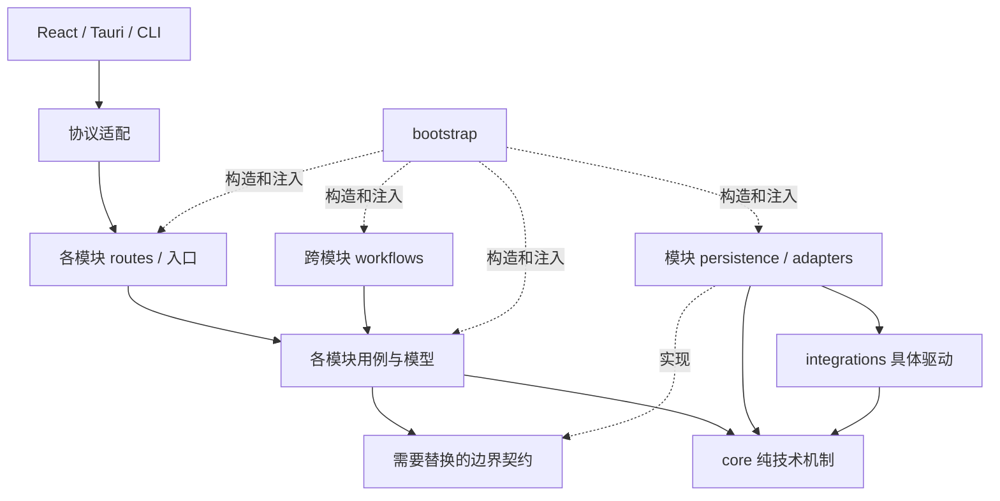

# Shinsekai 模块化 DI 目标架构

> 状态：目标架构，尚未实施。
> 日期：2026-10-16。
> 范围：Python src layout、feature 模块、纯技术 core、依赖装配与数据所有权。
> 迁移步骤与验收条件见 [模块化迁移计划](MODULAR_DI_MIGRATION_zh-CN.md)。
> 本文描述最终目标；现有代码并未自动满足这些规则。实施时按包同步更新 `PROJECT_STRUCTURE.md` 和架构测试。

## 1. 目标与当前问题

采用模块化单体：按 feature 组织 `src/shinsekai/application/modules/`，每个模块拥有自己的
模型、输入输出 schema、业务规则、持久化、状态和接口入口。跨模块流程显式编排，
启动入口构造依赖；`src/shinsekai/core/` 只容纳与 Shinsekai 产品业务无关的技术能力。
HTTP 服务器与聊天子进程继续存在，架构迁移与更换通信协议分别处理。

一个 feature 的规则、模型、存储和接口应尽量在同一模块内变化。
跨多个页面使用同一业务能力，不意味着该能力需要移入 core。

### 1.1 首要目标：让功能改动局部化

本次重构的动机是：新增一个小功能时，当前经常需要沿多个目录和层逐项修改，
同步重复字段、转发入口、操作枚举和分发表。成功标准是减少这种修改传播，
不是增加目录层数，也不是把同一条长调用链原样放进 modules。

普通 feature 改动应主要落在该模块、对应前端功能和相关测试内。
真正改变公开协议、数据格式或跨业务流程时，才需要相应边界的共同修改。
减少无意义的同步工作，不能以把所有业务塞回单个文件来追求最少编辑文件数。

据此固定以下设计要求：

- 一个模块不是固定的 api → facade → service → manager → repository 层级模板。
  HTTP 入口调用实际用例，用例调用存储/外部能力；每个保留层都要承担独立职责。
- 已由路由确定的普通操作，可直接调用 `CharacterService.save(...)` 等用例。
  无需再经全局操作枚举、Request 包装、通用 execute 和另一张中央分发表。
  跨进程消息等真实协议仍保留明确的命令契约。
- 模型、schema、存储映射有真实差异时才分离。一个普通字段不能为了目录规范
  在多个等价 Python 类型、手写字典和转发函数中重复声明。
- 每个模块注册一次自己的路由/服务。新增模块内操作通常只改本模块，
  不要求修改 core Router、全局容器类或全局 API 分发表。
- core 的参数化技术机制对 feature 字段和操作保持稳定。若新增角色字段需要修改
  通用 HTTP、日志或任务框架，应重新检查边界。
- 前后端公开契约明确选择权威定义，可逐步生成 TypeScript 类型和客户端描述，
  减少人工同步。生成只针对明确公开的契约，不直接暴露所有存储字段。
- 前端也按 feature 收口类型与 HTTP/preview 适配；shared/platform 保留通用传输
  和能力选择。新增角色操作不应要求在全局平台类型和中央实现文件重复添加同一声明。
  有真实 preview 行为时仍需实现该行为，类型生成不能替代业务实现。

例如，当前保存角色经 `routes/character_routes.py` → `frontend_bridge_core/characters.py`
→ CharacterOperation/CharacterRequest → `CharacterUseCase.execute` 的分发 → `_save`
再操作管理器和配置。目标是 character 模块自己的 routes → 实际保存用例 → 角色 store。
校验、授权、并发控制与资源所有权仍明确保留，不以删除必要边界换取短调用链。

当前代码中需要实际消除的耦合包括：

- `application/runtime/state.py` 的 `BridgeState` 聚合配置、角色、任务、聊天、故事、
  插件、认证和传输状态。用例拿到它，就可以访问几乎整个应用。
- `frontend_bridge_core/routes/router.py` 的请求对象携带这份状态。
- `application/characters/management.py` 的 `CharacterUseCase` 依赖整个 state，
  通过它取得配置和其他管理器。
- `frontend_bridge_core/config.py` 同时承担配置响应、校验、保存和模型发现等工作；
  `system_routes.py` 还直接修改配置、保存文件并应用语言设置。
- `config/schema.py` 和单例 `ConfigManager` 聚合多个业务域的数据。
- `application/runtime/context.py` 存在全局 runtime accessor；
  `application/chat/composition.py` 在导入时构造默认服务实例。
- `core/story`、`core/chat_history`、`core/messaging` 等包含故事、历史和聊天轮次规则，
  它们虽可独立测试，仍然属于 feature，而不是通用基础设施。

目录搬迁本身不会解决这些问题。迁移完成的标志是依赖和写入所有权改变，
而不是出现了 `modules/` 或 `container.py`。

## 2. 目标结构

```text
Shinsekai/
  pyproject.toml                         # Python 包发现、构建元数据、CLI 入口
  pytest.ini                             # 保留当前测试入口；工具配置只保留一个权威来源
  requirements*.txt                       # 现有依赖与运行时清单
  src/                                   # Python 源码根；src 本身不是 Python 包
    shinsekai/                           # 宿主实现的唯一顶层命名空间
      __init__.py                        # 无启动副作用
      __main__.py                        # python -m shinsekai 的命令分发
      application/
        bootstrap/                       # 具体对象图、配置与资源生命周期装配
          app.py                         # 宿主进程与模块装配
          project.py                     # 项目级路径、各模块 store 与服务
          chat_runtime.py                # 聊天子进程独立装配
          http.py                        # 应用路由、来源/认证策略与错误映射的装配
        workflows/
          story_chat.py                  # 故事/聊天关联及失败补偿
        modules/
          settings/
          character/
          background/
          effect/
          template/
          chat/
          story/
          memory/
          knowledge/
          agent/
          reminders/
          image_generation/
          avatar/
          tooling/
          plugins/
          model_assets/
          app_update/
          diagnostics/
          localization/
      core/                              # 通用基础设施和技术机制
        di/                              # 如需要：通用容器、作用域，不注册具体 feature
        storage/                         # 通用文档存储；需要时增加数据库连接/事务
        logging/                         # 通用日志配置与上下文
        errors.py                        # 少量确实共享的技术错误契约
        transport/
          http/                          # 路由匹配、请求/响应、multipart、通用服务器
          websocket/                     # 连接、握手/帧与通用发送接收机制
        tasks/                           # 任务登记、执行、进度、取消和状态
        templates/                       # 无业务内容的有序文本组合/渲染引擎
        i18n/                            # 语言包查找、插值与参数化回退机制
        serialization/                   # 通用值投影与编解码
        security/                        # 通用输入/HTTP/URL 校验机制
        files/                           # 原子写入、安全归档；与 storage 复用同一实现
        network/                         # 下载、取消、完整性校验等机制
        processes/                       # 跨平台启动、进程组与终止机制
        concurrency/                     # 有实际需要的取消传播等机制
        runtime_env/                     # 参数化解释器检查和依赖操作
      integrations/
        ai/
          llm/
          tts/
          asr/
          t2i/
          vision/
        mcp/
        plugins/
      resources/
        locales/                         # 应用文案目录，作为包资源分发
    sdk/                                 # 保留 from sdk import ... 的公共命名空间
      __init__.py
      cli/
  frontend/                              # 独立的 React / Tauri 构建根
    package.json
    pnpm-lock.yaml
    src/
      app/
      entities/
      features/
      modules/
      shared/
      test/
    src-tauri/
      Cargo.toml
      tauri.conf.json
      src/
      resources/                         # 构建时暂存的 Python 与其他资源
  test/
    unit/
      application/modules/
      core/
      integrations/
      sdk/
    integration/
    e2e/
  docs/
  scripts/
  tools/                                 # 开发/维护工具，不是宿主业务源码
  assets/                                # 随程序分发的资源
  data/                                  # 用户数据，保持当前物理路径与格式
  plugins/                               # 用户安装的插件内容
  runtime/                               # 生成的内嵌 Python 运行时
  .github/
```

本文后续目标路径中的 `application/`、`core/`、`integrations/` 均相对于
`src/shinsekai/`；`sdk/` 相对于 `src/`。第 1 节及迁移计划的“当前实现”列仍指迁移前仓库根路径。
Python import 使用 `shinsekai.application...`、`shinsekai.core...`、`sdk...`，不使用 `src.*`。
前端和 Rust 使用各自构建体系的源码根，不能用 Python 的 src layout 混合其包发现。

### 2.1 普通模块的内部形态

```text
src/shinsekai/application/modules/character/
  __init__.py
  api.py                      # 明确的模块公共类型与能力
  models.py                   # 角色/立绘/语音业务模型及不变量
  schemas.py                  # 与模型确有差异的输入输出格式
  service.py                  # 业务用例
  persistence.py              # 角色数据映射与保存，不是通用存储引擎
  assets.py                   # 角色资产操作
  errors.py                   # 角色不存在、名称冲突等业务错误
  routes.py                   # 请求/响应和业务错误映射
  module.py                   # 需要时使用的本模块装配工厂
  migrations/                 # 如有版本升级：本模块的数据迁移
```

这是一份职责示意，不要求每个模块都有同样的文件。小模块可以只有
`models.py`、`service.py`、`persistence.py` 和 `routes.py`。
装配复杂时再增加 `module.py`；公共导出分散时再增加 `api.py`。
`api.py` 只组织公开契约和导出，不增加一组重复转发函数。

大模块内部按已有稳定职责划分。聊天模块保留 #393 中的 host、runtime、history、
presentation 边界，不把已有解耦成果压回一个巨型 `service.py`。

```text
src/shinsekai/application/modules/chat/
  api.py
  models.py
  schemas.py
  errors.py
  routes.py
  module.py
  host/
  runtime/
  history/
  presentation/
  dialog_media/
```

### 2.2 包发现、启动与资源

开发环境用项目包的 editable 安装暴露 `src` 中的包；`pyproject.toml` 显式发现
`src/shinsekai` 与 `src/sdk`。正常启动为 `python -m shinsekai serve`，
运行时检查和聊天 worker 由同一入口的明确子命令分发。先选择子命令，再装配其需要的对象，
运行时检查不启动 HTTP 服务或模型引擎。SDK CLI 保留 `python -m sdk.cli` 的契约。

打包默认构建项目 wheel，并安装到该次打包专用的运行时/资源暂存目录，
不能把当前项目包写进跨构建共享的 Python runtime 缓存。
包内模板、清单等静态文件由构建配置显式包含；外部 assets 和前端产物按资源清单暂存。
在隔离目录验证安装后的包可导入，不依靠仓库 cwd、临时修改 sys.path 或外部 PYTHONPATH 找到源码。

源码根不等于用户数据根或安装根。项目路径由 bootstrap 从启动参数/宿主上下文解析后注入；
模块不能通过 `__file__.parents[...]` 或 cwd 推断 `data/`。
没有项目格式变更时，移动 Python 源码不移动用户 YAML、历史、资产和插件目录。

`core/` 与 `integrations/` 的子目录同样按真实代码建立；目录树中的示例不要求增加
目前不存在的抽象或包装。已在 SDK 公开的纯技术工具保持单一实现，不为凑齐 core 目录复制一份。

## 3. 模块的数据与业务所有权

| 模块 | 自己拥有 | 通过依赖获得 |
| --- | --- | --- |
| settings | API 配置、系统偏好、默认值、配置迁移、设置保存 | 网络探测、环境设置应用等实际能力 |
| character | 角色、立绘/语音配置、角色集合持久化、角色资产操作 | 必需的语音策略、生成能力、文件访问能力 |
| background / effect | 各自的资源配置与持久化、管理用例 | 文件与生成能力 |
| template | 模板定义、校验、存储、模板编辑 | 角色/背景的公开查询能力 |
| chat | 会话、进程、命令、聊天历史、会话生命周期 | 设置快照、角色快照、故事能力、AI 工厂、传输端口 |
| story | 故事定义、版本、分支、选择与故事持久化 | 角色查询及必要的聊天能力契约 |
| knowledge / memory | 各自的资料、绑定关系、检索与存储 | 模型能力、角色标识和公开查询能力 |
| agent / plugins / model_assets | 各自的任务、插件宿主集成、模型资源用例 | 明确声明的应用能力和基础设施 |

其他已有 feature 的最终归属包括：reminders 管提醒规则与计划；image_generation 管生图任务；
avatar 管形象运行时和相关资产操作；tooling 管 MCP 配置、工具发现和执行授权；
diagnostics 管产品诊断包；app_update 管应用更新策略；localization 管业务字段翻译。
领域操作对应的 AI 工具适配器放回所属模块，例如 character 的修改工具、story 的选择工具。

`settings` 不接管全部 YAML。当前 `characters.yaml`、`background.yaml`、
`effect.yaml` 分别交给数据所属模块，不能把原来的 `ConfigManager` 原样搬进 settings。
角色语音策略依赖设置，不意味着角色模块可以任意修改设置存储。

一个模型只能有一个权威定义。业务模型已经能准确表达 API 或存储数据时可以复用；
只有兼容字段、校验规则或存储形态确实不同，才定义独立 schema 并做转换。
不为每个实体固定复制三份 model / DTO / persistence model。

现有聚合配置接口可以暂时保留，但其结果由各模块的公开查询组合出来，
它不拥有第二份可写数据，也不成为新的全局配置对象。

## 4. 去掉 bridge 后，协议适配如何归位

模块的 `routes.py` 负责自身请求校验、调用用例和响应投影；通用 HTTP 层负责
连接、认证机制、请求解析、上传下载和统一错误输出。此通用技术框架位于
`core/transport`，不放在 application。bootstrap / 模块入口提供具体认证策略、
业务错误映射、允许来源与路由；WebSocket 的聊天事件适配器属于 chat。

```text
HTTP 请求 → 模块 routes → 模块 service → 模块 persistence / 注入的能力
CLI、SDK 宿主适配器 ───────→ 模块公开用例
```

不再存在集中承接全部业务的 `frontend_bridge_core`。但现有 HTTP / WebSocket
边界仍需要具体实现；删除协议处理、安全检查或 DTO 转换不属于本方案。

模块内部的业务服务不接收 HTTP Request、Tauri 对象、Router 或完整 Application。
路由通过工厂/闭包绑定已构造的服务，不在每次请求时创建管理器，
也不通过 `request.state.container.get(...)` 查找依赖。

通用请求对象只包含传输需要的数据。过渡期旧路由所需的 state 由旧适配器提供，
不把 `BridgeState` 带入新的模块请求契约。

HTTP/WS 是技术协议，不因它们承载 feature 请求就成为业务模块。
实现可直接依赖成熟库，不要求重写协议；core 仅维护实际复用的机制与框架接口。

## 5. DI 与模块依赖规则

先采用显式构造函数和函数参数注入，不引入 DI 框架作为迁移前提。装配示意：

```python
settings = SettingsService(
    store=YamlSettingsStore(paths.config_dir),
    apply_effects=runtime_settings.apply,
)
characters = CharacterService(
    store=YamlCharacterStore(paths.characters_file),
    assets=CharacterAssets(paths.character_asset_dir),
    voice_policy=settings.voice_policy,
)
router = Router([
    *settings_routes(settings),
    *character_routes(characters),
])
```

这些对象只在 bootstrap 或相应模块工厂中创建。实际构造参数由被消费的能力决定，
不要求为了示意代码增加包装类型。

需要自建通用容器或作用域机制时，其实现可位于 `core/di`；具体 feature 的注册、
参数选择和对象连接仍属于 bootstrap / 模块工厂。若现成 DI 库可直接满足需要，
不再增加一套同义包装。业务服务通过构造参数得到依赖，不自行访问容器。

规则：

1. 模块可以依赖其他模块明确公开的类型和能力，不能导入其私有 persistence、
   修改其内部缓存或直接写它的文件。公开依赖组成有向无环图。
2. 跨模块流程由明确的用例协调。出现 chat 与 story 相互导入时，
   先将流程和端口拆开，再在 bootstrap 连接，不能用动态 import 绕过循环。
3. 对可变外部能力、持久化边界和需要替换的依赖使用窄 `Protocol` 或回调。
   不为每个单一实现固定配一个 Interface / Impl 对。
4. 类型归其业务所有者；只为满足测试 mock 而生造一套重复契约没有必要。
   SDK 继续只包含对外扩展契约，不用作内部业务模型的公共仓库。
5. `integrations/` 不依赖 feature 的模型、存储和应用状态。现有 `ai/` 与 `plugin_system/`
   按职责拆分：供应商驱动和宿主机制进入 integrations，带产品规则的代码进入对应模块。
   现有对 `config.schema` 的依赖由模块内适配器转换为供应商参数、值对象或窄契约，
   不把应用模型搬走后再新增下层到上层的循环依赖。
6. 根装配对象只由入口、路由装配和关闭流程持有。业务代码不能获取全局 container、
   导入 bootstrap，或调用全局 runtime accessor 获得隐藏依赖。
7. 模块导入不创建服务、启动线程、读取项目配置或加载模型。昂贵能力在其明确的
   启动步骤创建，或通过已注入的工厂延迟构造。

## 6. 生命周期与状态

| 范围 | 典型所有者与资源 |
| --- | --- |
| 宿主进程 | HTTP 服务、插件宿主、通用任务执行资源、日志和关闭协调 |
| 项目 | 设置与角色 store、项目路径、数据缓存和写入锁 |
| 聊天会话 | 进程监督器、流连接、会话/启动 ID、状态与下载能力 |
| 请求 / 任务 | 请求 schema、任务输入、取消和进度 |

每个模块的项目级 store 由装配入口构造一次，其调用者经该模块的公开能力使用它。
其他模块不直接取得 store。模块不能自行再创建单例管理器。
先支持当前产品实际需要的项目范围，不为假想多租户增加作用域框架。

宿主和聊天子进程分别构造自己的对象图；跨进程只传可序列化的启动配置、
身份和命令，不传 DI container 或活的服务对象。会话设置使用明确的快照，
保留 session ID / launch ID 和旧事件不能清理新会话的约束。

代理环境变量和全局 i18n 等属于进程级副作用，不能假装获得了项目隔离。
子进程优先通过启动环境快照配置；宿主侧的全局设置更新必须由明确所有者执行。

关键操作仍由资源所有者直接执行并报告错误：停止子进程、关闭流、保存历史、
释放日志和删除会话。业务动作不通过会吞异常的插件观察钩子完成。
根关闭流程按实际依赖逆序调用所有者，并在初始化部分失败时清理已创建的资源。

## 7. 持久化与兼容约束

- 先保持 `data/config/api.yaml`、`system_config.yaml`、`characters.yaml` 等现有
  路径、字段、默认值和恢复规则。迁移代码目录不移动用户数据。
- 每份可写数据只有一个权威 store；迁移后旧调用者要么委托该 store，
  要么明确只读，不能让新服务和旧 `ConfigManager` 各自缓存并保存同一份配置。
- 角色文件当前是集合数据。更新一个角色的 read-modify-write 必须由同一所有者
  协调，避免并发保存丢失其他角色的修改。保留现有锁、原子替换和失败恢复语义。
- settings 保存涉及持久化、缓存与运行时副作用。先用现有行为测试锁定其顺序，
  对部分成功的处理另作明确决定；不能把副作用丢到观察事件中并返回成功。
- 保留当前 HTTP URL、状态码、JSON 形状、任务/流通知、资源下载授权和路径策略。
  API 变更与架构迁移分开提交，不同时更换前端状态模型。
- SDK 公开类型、初始化/生命周期钩子和宿主行为保持兼容。
  SDK 宿主适配器可以调用模块能力，SDK 本身不能导入 application 实现。
- 最后切换到 `python -m shinsekai` 时，同时更新 Tauri 的 managed/resolver、运行时检查、
  资源暂存、打包验证和命令行脚本，不能只删除 `frontend_bridge.py`。

## 8. core 的准入标准

core 是技术机制库。它可以知道文件、字节、URL、进程、锁、时间、取消和校验和，
不能知道角色、会话、故事、立绘、模型包目录、产品配置和插件生命周期。

| 可以进入 core | 应属于 feature 或装配层 |
| --- | --- |
| 通用 DI 注册/解析、作用域和资源管理机制 | 注册具体业务类、选择实现、连接应用生命周期 |
| 文档存储、数据库连接和事务机制 | CharacterRepository、领域字段映射、数据迁移和业务事务边界 |
| 通用日志格式、上下文与轮转，少量共享技术错误 | 日志目录/级别配置、角色/会话信息、业务异常及 HTTP 状态映射 |
| HTTP 路由、multipart、WebSocket 连接机制 | API 业务路由、Tauri 来源规则、聊天事件协议和业务错误映射 |
| 任务状态、执行、进度、取消；通用线程执行机制 | 任务要做什么、业务阶段、取消后的资源清理与展示文案 |
| 有序文本组合、语言包查找、插值与序列化 | 角色/故事提示词内容、产品文案、默认语言及领域字段映射 |
| 给定路径的原子写入、安全归档、哈希校验 | 如何保存角色、故事、历史；具体业务文件名及版本迁移 |
| 给定参数的下载与字节进度、通用重试机制 | 模型包清单、供应商选择、下载/解压各占多少进度 |
| 队列、锁、取消信号与进程组操作 | 聊天打断、输入合批、退出后保存历史、重启策略 |
| 参数化的解释器检测与依赖安装 | Shinsekai 运行时 profile、TTS/CUDA 选型、镜像区域偏好 |
| 与领域无关的解析或图算法 | 对话 JSON 修复、故事节点语义、角色选择和效果绑定 |

判断一个实现是否可以进入 core，逐项检查：

1. API 不接收 Character、ChatSession、Story、AppConfig 等领域类型，
   不从全局对象间接获取这些数据。
2. 去掉 Shinsekai 的 feature 后，这个实现仍有独立、明确的技术含义。
3. feature 政策变化不要求修改它；技术机制变化才可能修改它。
4. 测试可使用任意临时文件、URL、进程或普通值完成，不需要产品数据、
   SDK 业务消息或模块初始化。
5. 不读取 `SHINSEKAI_*`、`EASYAI_*` 等产品上下文来决定工作目录、数据或供应商；
   调用者显式传参。与平台本身相关的技术环境读取应有明确边界。

“纯函数”“框架无关”“有多个调用者”都不足以单独证明它属于 core。
业务能力复用时使用所属模块的公开 API。

具体例子：`ChatTurnService` 管输入合批和打断，即使只依赖回调，也属于 chat；
`StoryCompiler` 是纯计算，仍然属于 story；`core/paths.py` 中解析产品根目录的逻辑
属于 bootstrap。下载器可以报告已接收/总字节，当前硬编码的 0–70% 阶段权重应由使用下载器的用例决定。

现有 `core/security/paths.py` 是 SDK 路径工具的兼容转发。消费者直接使用权威实现后
删除该转发，不为统一目录再次复制安全代码。SDK 的既有公开技术工具保留其契约。
最终 core 自身仅依赖标准库、通用第三方库与 core 内部代码。

`core/storage` 使用通用文件能力实现文档读写，不再复制 `core/files` 的原子写入。
数据库连接/事务仅在实际引入该后端时实现，模块的 persistence 负责领域存取与数据版本。
日志由 bootstrap 选择输出位置、级别并初始化；各组件可直接使用标准 logging。
技术异常归产生它的组件，业务异常归模块，接口入口声明映射、transport 统一输出。
保留异常原因，在有处理责任的边界记录，避免每层重复记录或吞掉必要操作的失败。

不再另建 `application/shared` 来承接移出 core 的业务。归属不清的代码先留在实际
消费者附近，识别业务所有者后迁移；只在真实的技术复用或隔离需求出现时提取 core 能力。

### 8.1 现有代码中的通用技术候选审查

以下是对当前代码的归属审查，不表示已完成移动。大部分需要先拆依赖，不能直接整文件搬迁。

| 当前来源 | core 的目标能力 | 必须留在应用/模块的内容 |
| --- | --- | --- |
| `frontend_bridge_core/routes/router.py`、`uploads.py` | `transport/http` 的匹配、重复路由检测、请求/响应值、multipart 与上传资源机制 | ApiRequest 的 BridgeState、具体任务/业务路由；应用上传策略由入口提供 |
| `frontend_bridge_core/routes/http_handler.py`、`transport/ws_client.py` | `transport/http` / `websocket` 的通用收发和连接机制 | Agent 错误映射、Tauri 来源、轮询路径、ChatEventSink、资源 URL 和聊天协议 |
| `application/runtime/tasks.py` | `tasks` 的任务存储、锁、执行与取消状态、进度与结果 | BridgeState、任务文案、下载已清理的断言、具体 worker 的业务和清理责任 |
| `application/runtime/workers/base.py` 的线程部分 | `concurrency` 的启动/等待/停止请求机制 | getCharacter、全局配置回退、SDK DagNode 适配；不能把 SDK 依赖带入 core |
| `ai/llm/template/core/context.py`、`section.py` | `templates` 的上下文传递、有序节点组合与渲染 | dialog/story/reminder 的提示词内容及其业务上下文 |
| `i18n/__init__.py` 的查找/格式化部分 | `i18n` 的语言包查找、插值与可配置回退 | 内置资源路径、支持语言、当前语言选择和全局默认；字段翻译业务仍归 localization |
| `application/runtime/state.py::_jsonify` | `serialization` 的通用 JSON 值投影；当前已有多个实际消费者 | 每个 API 选择输出哪些字段及其业务转换 |
| `frontend_bridge_core/security.py` 的通用函数 | `security` 的 header、URL、host 和输入检查 | 哪些来源/端口/目录/操作可访问，由应用/模块制定；已有 SDK 路径工具不复制 |

core/tasks 不承诺任务被取消就已清理业务资源。取消传播与完成状态是技术机制，
删除下载内容、补偿资产写入等动作由 worker 的资源所有者执行并报告结果。

SDK 中的 `graph`、`logging`、`path_utils`、`file_io` 也有通用技术内容，但已有公开契约。
本轮不把它们复制到 core。归属调整须另做兼容设计，保持 SDK 可独立导入且无宿主反向依赖；
候选抽取可通过注入复用必要的技术能力，不能机械迁移后让 core 导入 SDK。

反例：`application/runtime/event_sink.py` 的聊天快照归并、story 的 command/revision/event
幂等记录、`shutdown_chat_runtime` 的保存/关闭顺序，以及 memory 的对话分块预算，
均包含业务语义，继续归所属模块。只含字典、回调或纯计算不代表整个文件都应该进入 core。

## 9. 依赖矩阵与公开边界

| 来源 | 允许的依赖 | 禁止的依赖 |
| --- | --- | --- |
| core | 标准库、通用第三方库、core | application、integrations、config、sdk、frontend；任何产品业务契约 |
| sdk | 标准库、第三方库、SDK 自身 | 宿主模块、bootstrap、integrations；保持扩展契约可独立导入 |
| integrations | core、SDK 公共协议、第三方驱动及自身技术类型 | feature 内部模型/存储、BridgeState、产品全局配置 |
| 模块 models / service | 自身模型与窄契约、core、必要的 SDK 契约、声明过的其他模块公开 API | HTTP Request、容器、bootstrap、其他模块 persistence |
| 模块 persistence / adapters | 自身模型与契约、core、SDK、integrations | 其他模块私有实现和全局状态定位器 |
| 模块 routes | 自身服务/schema、通用传输类型 | 直接操作 store、创建管理器、编排其他模块业务 |
| workflows | 必需模块的公开 API | 模块私有存储、直接修改模块状态 |
| core/transport | 通用协议机制、core、已注册的处理器/策略契约 | 导入 feature、按业务路径分支、Agent 错误映射、构造业务服务 |
| bootstrap | 所有需要装配的实现与公开 API | 包含业务决策或成为业务服务查询入口 |



图中的虚线表示实现或装配关系，不是运行时服务查找。只有真实需要替换的边界才定义契约。
单个简单稳定函数可以直接使用，跨模块查询也可以直接消费声明过的公开 API。

有跨模块消费者时，用小型 `api.py` 或明确的包导出声明公共表面，
只导出稳定的命令/结果、不可变快照、契约与真实服务，不导出内部 store 和默认实例。
若持久化端口只由本模块 service 消费，可以就近定义，不为满足目录模板增加空 `ports.py`。

路由属于模块的接口适配部分，因此可以引用通用传输类型；模块业务代码不能引用它。
模块公开 API 不导入 routes，避免查询一个角色就加载 HTTP、模型引擎或整个应用。
独立测试不能依靠替换 `sys.modules` 或构造全局 state 隐藏错误的依赖方向。

## 10. 跨模块流程、命令与事件

以“启动故事聊天”为例：`workflows/story_chat.py` 接收 story、character、chat 的
窄公开能力，准备故事会话和角色快照，调用聊天启动，并在失败时按资源所有权补偿。
story 的规则与存储仍在 story，chat 的进程与会话仍在 chat，workflow 只拥有两者的关联流程。

| 协作类型 | 方式 |
| --- | --- |
| 查询设置、角色或故事快照 | 显式调用公开查询，结果不暴露可写缓存 |
| 必须得到结果或保证顺序的动作 | 直接调用/等待用例，显式处理失败和补偿 |
| 诊断、统计、插件观察 | 发布含身份的不可变事件，隔离观察者异常 |

自发进程退出等情况由所有者向必要应用处理器交付，并报告处理失败。
可注入必需的跨模块协调能力，但不能让保存历史、删除会话等动作依赖可选观察者。
不得通过“所有操作都改成事件”消除静态依赖，同时留下无法判断的执行顺序。

跨模块的多文件修改不是天然事务；用例明确哪些资源已经提交、哪些可以补偿、
补偿失败如何恢复。core 只提供文件/锁等机制，不负责决定业务回滚。

## 11. 完成后的可观察结果

- 一次普通小功能的主要手工修改集中在所属 feature；新增字段和操作不再传播到多张中央表与多层同义转发。
- 一个 feature 的 API、模型、规则与数据读写主要在它自己的模块内维护。
- 新增入口只需绑定现有用例，业务服务不依赖入口是 HTTP、CLI 还是插件。
- 测试构造服务时可以看见全部必要依赖，导入模块没有启动副作用。
- core 中没有故事、对话、角色、立绘和产品配置政策；其他 feature 复用这些能力时调用所属模块。
- 不存在全局 ConfigManager 聚合单例、BridgeState 或通用服务定位器。
- 具体 AI/插件驱动不需要导入整个产品配置和领域模型。
- 文件路径、API、SDK、资源释放和打包行为有迁移前后的契约验证。

落地次序、旧代码去向、每个阶段的退出条件及 PR 划分见
[模块化迁移计划](MODULAR_DI_MIGRATION_zh-CN.md)。
