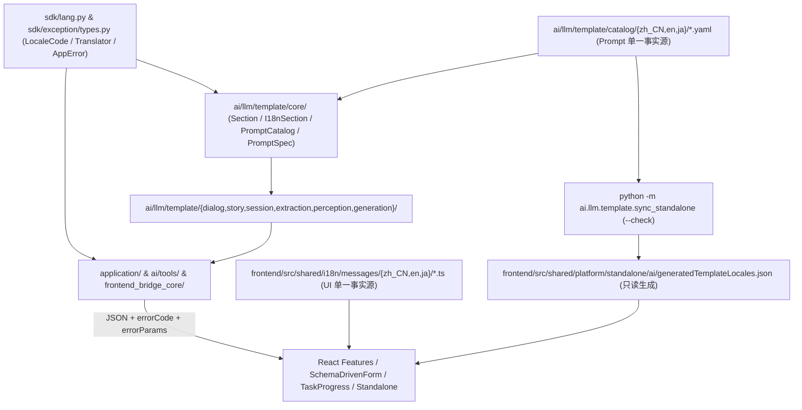

# Shinsekai 统一提示词（Prompt）与全栈国际化（i18n）架构及迁移方案

> 日期：2026-11-21
> 分支：`feat/prompt-i18n-architecture`（基于 `origin/main`：`a52142d17`）
> 相关基线文档：[`PROJECT_STRUCTURE.md`](PROJECT_STRUCTURE.md)、[`PROJECT_STRUCTURE_MIGRATION.md`](PROJECT_STRUCTURE_MIGRATION.md)、[`ai/llm/template/README.md`](../ai/llm/template/README.md)

本文档定义 Shinsekai 内置提示词体系与全栈（Python / Bridge / React / Standalone）国际化的统一目标架构、依赖边界、自动化防回退门禁（Guardrails），以及分阶段可验证迁移路线图（P0–P6）。当前阶段仅完成架构设计与迁移规划，尚未开始业务代码重构。

---

## 1. 现状全景诊断与根因分析

当前仓库表面上是「提示词没全用 `Section`、UI 漏了几处 i18n」，但前后端交叉排查后可以确认：**两者同源**——仓库处于「主对话模板刚完成 Composite `Section` 化、旧桌面端退出但语言包与提示词尚未完成统一收敛」的半重构状态，且缺乏静态硬编码门禁，导致新增代码持续回退到硬编码。

### 1.1 内置提示词（Prompt）四大痛点

1. **`ai/llm/template/` 内部规范与语种就已经分裂**
   - **主对话链路仍有遗留硬编码**：[`ai/llm/template/dialog/`](../ai/llm/template/dialog/) 大部分通过 `DialogTemplateContext.translate` 读取 `template_gen.*`，但以下位置仍直接写死自然语言：
     - [`ai/llm/template/dialog/sections/player.py`](../ai/llm/template/dialog/sections/player.py)：`format_self_persona_prompt`（L12–L20）硬编码中文 `【用户自设设定】...`；
     - [`ai/llm/template/dialog/sections/field_requirements.py`](../ai/llm/template/dialog/sections/field_requirements.py)：L108、L117 硬编码英文 `Aliases: ...` 与 `Do not include this field in the output.`；
     - [`ai/llm/template/prompts/user.py`](../ai/llm/template/prompts/user.py) 与 [`application/chat/runtime/background_prompt.py`](../application/chat/runtime/background_prompt.py)：硬编码中文标签 `[当前显示背景]` 与 JSON 键名 `"图片"` / `"背景组"` / `"背景编号"` / `"描述"`；
     - [`application/chat/templates.py`](../application/chat/templates.py) L39（以及独立模式 [`templateGenerator.ts`](../frontend/src/shared/platform/standalone/ai/templateGenerator.ts) L17）：`DEFAULT_EMPTY_SCENARIO = "你扮演一个RPG系统。"` 硬编码中文兜底。
   - **非主对话 `Section` 直接把英文/中文大段写死在节点里**：
     - [`ai/llm/template/reminder.py`](../ai/llm/template/reminder.py)：`build_reminder_system_section()` 直接写入大段纯英文规则；
     - [`ai/llm/template/story/author.py`](../ai/llm/template/story/author.py)：纯英文文案，且模块顶层 `AUTHOR_COMPILER_TEMPLATE = build_story_author_system_section().render(TemplateContext())` 在导入期静态求值，导致无法按请求切换语种；
     - [`ai/llm/template/story/assessment.py`](../ai/llm/template/story/assessment.py) 与 [`ai/llm/template/story/guidance.py`](../ai/llm/template/story/guidance.py)：纯中文文案与中文字段 JSON（`"当前剧情"`、`"剧情要求"` 等）。

2. **大量子系统完全绕开 `Section` 手拼 `messages` 字符串**
   - **会话维护**：[`ai/llm/compact_manager.py`](../ai/llm/compact_manager.py)（`_create_compact_prompt` 与 `_call_llm_for_compaction` 硬编码中文总结指令）、[`ai/llm/dialog_repair.py`](../ai/llm/dialog_repair.py)（`_repair_prompt` 硬编码英文 JSON 修复提示）。
   - **记忆与知识库提取及上下文注入**：
     - [`ai/memory/extraction.py`](../ai/memory/extraction.py)：英文指令中混入中文相对时间示例（`'明天', '昨天', '下周'`）；
     - [`ai/knowledge/extraction.py`](../ai/knowledge/extraction.py)：纯英文 system / user prompt；
     - [`ai/memory/hooks.py`](../ai/memory/hooks.py)（`[Shinsekai long-term memory context]`）、[`application/knowledge/hooks.py`](../application/knowledge/hooks.py)（`[Shinsekai knowledge context]`）、[`application/chat/capabilities/outfit.py`](../application/chat/capabilities/outfit.py)（`[当前角色服装分组状态]`）各自拼接系统注入块。
   - **感知与视觉**：
     - [`ai/perception/prompts.py`](../ai/perception/prompts.py)：`build_voice_style_messages` 与 `build_perception_messages` 超过 200 行 `if/else` 字符串拼接；
     - [`ai/perception/cloud_summary.py`](../ai/perception/cloud_summary.py)：`build_cloud_summary_messages` 整块纯中文 JSON 约束；
     - [`core/perception/cache/formatter.py`](../core/perception/cache/formatter.py)：`PROACTIVE_TURN_INSTRUCTION` 与 `render_rp_context` 将筛选算法与中文呈现文本（`[总体纪要]`、`[分段纪要]`）紧耦合在 `core/` 层；
     - [`ai/vision/service.py`](../ai/vision/service.py)：`DEFAULT_IMAGE_PROMPT` 纯英文硬编码。
   - **业务生成与工具描述**：
     - [`application/characters/generate_briefs.py`](../application/characters/generate_briefs.py)（`CHARACTER_BRIEF_PROMPT` 与批量生成 system prompt）、[`application/story/scene.py`](../application/story/scene.py)（`SCENE_RENDERER_TEMPLATE`）、[`application/localization/field_translation.py`](../application/localization/field_translation.py)；
     - [`application/characters/sprite/generate_sprites.py`](../application/characters/sprite/generate_sprites.py)、[`animate_sprites.py`](../application/characters/sprite/animate_sprites.py)、[`mouth_sync.py`](../application/characters/sprite/mouth_sync.py)、[`transition_sprites.py`](../application/characters/sprite/transition_sprites.py)、[`application/media/auto_annotation.py`](../application/media/auto_annotation.py)、[`application/media/sprite_tags.py`](../application/media/sprite_tags.py)；
     - [`ai/tools/*.py`](../ai/tools/)（如 [`ai/tools/memory_tools.py`](../ai/tools/memory_tools.py) 在 `@tool(description=...)` 中混用英文规则与中文示例）。

3. **长提示词挤占 UI 语言包，且依赖进程全局可变状态**
   - [`i18n/locales/zh_CN.json`](../i18n/locales/zh_CN.json)（736 行，含 540 个键值）中，`template_gen` 占 78 个长提示词键值（L656–L735），将带缩进、换行、双花括号 JSON 示例的提示词压为单行转义 JSON，可读性与 Git diff 审查体验极差。
   - [`i18n/__init__.py`](../i18n/__init__.py) 的 `tr()` 依赖模块级全局状态 `_current`。定时提醒（[`application/reminders/workflow.py`](../application/reminders/workflow.py) 已不得不用 `tr_in_bundle` 绕开）、后台异步记忆提取、以及未来「英文 UI + 日/中文角色扮演」并发场景下极易串语言。

4. **前端 Standalone 模式手抄后端提示词导致双份失步**
   - [`frontend/src/shared/platform/standalone/ai/standaloneTemplateLocales.ts`](../frontend/src/shared/platform/standalone/ai/standaloneTemplateLocales.ts)、[`compactManager.ts`](../frontend/src/shared/platform/standalone/ai/compactManager.ts)、[`dialogPromptBuilder.ts`](../frontend/src/shared/platform/standalone/ai/dialogPromptBuilder.ts) 手工复制了后端 `template_gen` 与压缩文案。
   - 经比对，独立模式已比后端 [`i18n/locales/zh_CN.json`](../i18n/locales/zh_CN.json) 的 `template_gen` 少 8 个键（含新增核心约束 `r_user_display_name_tool`、`closing_tool_protocol` 及 `tools_*`），且 [`compactManager.ts`](../frontend/src/shared/platform/standalone/ai/compactManager.ts) 与后端 [`ai/llm/compact_manager.py`](../ai/llm/compact_manager.py) 文案完全各自演进。

### 1.2 全栈 UI 与 Bridge 国际化（i18n）四大痛点

1. **三套孤立字典并存 + 大量历史死词条**
   - Python [`i18n/locales/*.json`](../i18n/locales/) 仍保留 462 个非 `template_gen` 键值（对应旧桌面端 PySide/Qt `ui/` 窗口），其中约 95% 随着 `ui/` 退出已不再被调用；全仓库仅剩聊天运行态通知、命令行参数、工具确认与局部媒体忙碌提示等十余处调用 `tr()`。
   - 前端主字典 [`frontend/src/shared/i18n/messages.ts`](../frontend/src/shared/i18n/messages.ts) 按 12 个域切片且受 [`i18n.test.ts`](../frontend/src/test/shared/i18n/i18n.test.ts) 强校验，但存在两处体系外字典：
     - [`frontend/src/features/onboarding/onboardingCopy.ts`](../frontend/src/features/onboarding/onboardingCopy.ts) 独立维护 489 行三语字典；
     - [`frontend/src/app/shell/SidebarNav.tsx`](../frontend/src/app/shell/SidebarNav.tsx) 混用 `labelKey`、内联 `{ en, ja, zh_CN }`（L37）以及裸写中文 `"AI / 跨端配置"`（L288/L292）与 `"移动端底部导航"`（L308）。

2. **新功能页面与跨端组件直接裸写中文**
   - 代表性文件：[`RuntimeModeDialog.tsx`](../frontend/src/features/runtime-mode/RuntimeModeDialog.tsx)（60+ 处标签、默认文案与 Toast）、[`AppShell.tsx`](../frontend/src/app/shell/AppShell.tsx)（`DECORATE_SUBNAV` / `SYSTEM_SUBNAV`）、[`TopStageTools.tsx`](../frontend/src/features/chat-stage/components/TopStageTools.tsx)（L95/L102）、[`PathPickerDialog.tsx`](../frontend/src/shared/ui/PathPickerDialog.tsx)（L203–L225 独立模式提示）、[`ErrorBoundary.tsx`](../frontend/src/shared/ui/ErrorBoundary.tsx)（L43–L52）、[`LogsPage.tsx`](../frontend/src/features/logs/LogsPage.tsx)、[`MusicCoverPage.tsx`](../frontend/src/features/music-cover/MusicCoverPage.tsx)、[`shared/platform/slices/*PreviewPlatform.ts`](../frontend/src/shared/platform/slices/) 与 [`shared/platform/standalone/`](../frontend/src/shared/platform/standalone/)。

3. **静态表单 Schema 与通用状态组件写死中文映射**
   - [`frontend/src/entities/config/schema.ts`](../frontend/src/entities/config/schema.ts) 在模块顶层把 `apiConfigFormSchema`、`systemConfigPageSchema`、`adapterExtraSchema` 的 `title / label / description` 写死为中文常量；[`SchemaDrivenForm.tsx`](../frontend/src/shared/ui/SchemaDrivenForm.tsx)、[`AdapterExtraForm.tsx`](../frontend/src/features/api-settings/AdapterExtraForm.tsx)、[`apiSettingsUtils.ts`](../frontend/src/features/api-settings/apiSettingsUtils.ts)、[`SystemSettingsPage.tsx`](../frontend/src/features/system-settings/SystemSettingsPage.tsx) 直接消费或拼接这些中文字符串。
   - [`frontend/src/shared/ui/TaskProgress.tsx`](../frontend/src/shared/ui/TaskProgress.tsx)（L42–L90+）将 `phaseLabels`、`packageStatusLabels`、`dependencyStatusLabels` 全部写死为中文映射表。

4. **Bridge/SDK 裸抛中文错误 + 靠匹配中文前缀做业务逻辑（高危隐患）**
   - **高危正则/前缀逻辑耦合**：
     - [`frontend/src/features/chat-stage/state/text.ts`](../frontend/src/features/chat-stage/state/text.ts) L77–L85 用正则 `/^(已跳过|已选择|选择：|历史|浏览器预览历史|语音识别|正在请求|聊天会话|您的消息已提交|进程已经|当前聊天会话|实时聊天会话)/` 识别系统提示消息；
     - [`frontend_bridge_core/backgrounds.py`](../frontend_bridge_core/backgrounds.py) L91、L99 用 `message.startswith("找不到") or message.startswith("请") or "出错" in message` 判定保存标签是否失败；
   - **后端直传不可翻译文案**：[`frontend_bridge_core/config.py`](../frontend_bridge_core/config.py)、[`tools.py`](../frontend_bridge_core/tools.py)、[`chat_session.py`](../frontend_bridge_core/chat_session.py)、[`plugin_ui.py`](../frontend_bridge_core/plugin_ui.py)、各 [`routes/*.py`](../frontend_bridge_core/routes/) 与 [`sdk/exception/types.py`](../sdk/exception/types.py)（`_download_user_message`）直接抛出中文或写入 `task.message` / `task.title`，前端原样弹 Toast。
   - **持久化存储值与 UI 展示 Label 耦合**：`"硅基流动"` / `"豆包"` / `"通义千问"`（`llm_provider` 主键）、`"自设"`（`SELF_PERSONA_NAME`）、`"透明场景"`（`TRANSPARENT_BG`）、`"默认"`（`DEFAULT_SPRITE_GROUP`）同时充当存档键名与界面文案。

---

## 2. 总体架构原则与依赖边界

### 2.1 四项核心设计原则

1. **两套单一事实源（Two Single Sources of Truth）**
   - **Prompt 唯一事实源**：`ai/llm/template/catalog/{zh_CN,en,ja}/*.yaml`。采用 YAML 多行块标量（`|` / `|-`），免去 JSON 引号与 `\n` 转义，Git diff 清晰；Python 运行期直接加载，前端 Standalone 模式由构建同步脚本 `python -m ai.llm.template.sync_standalone` 单向导出为只读 TS 文件，不向前端引入任何 YAML npm 解析依赖。
   - **UI 唯一事实源**：`frontend/src/shared/i18n/messages/{zh_CN,en,ja}/*.ts`。承载全部 React 页面、Onboarding、表单 Schema、任务状态及结构化错误码译文；Python [`i18n/locales/*.json`](../i18n/locales/) 剥离 `template_gen` 与废弃旧 Qt 词条后，仅保留少量后端进程直出通知。

2. **统一跟随 `ui_language` 的显式语言流（无状态并发安全）**
   - 提示词不另设独立配置项，除 L3 下游契约锁语种的模块外，所有内置提示词统一跟随 [`config/schema.py`](../config/schema.py) 中的 `SystemConfig.ui_language`（经 `sdk.lang.normalize_lang` 归一化为 `"zh_CN" | "en" | "ja"`），确保界面语言与 AI 提示词语言始终同步切换。
   - 在架构内部，所有提示词渲染均通过上下文显式传入 `locale` / `Translator`（`LocalizedContext` / `DialogTemplateContext`），彻底废除模块导入期 `.render()` 全局字符串常量与对进程全局状态 `i18n._current` 的隐式依赖，保证后台异步任务与多线程请求互不串语种。

3. **严格遵守 AST 包依赖边界（零 `ALLOWED_VIOLATIONS`）**
   - 延续 [`PROJECT_STRUCTURE.md`](PROJECT_STRUCTURE.md) 与 [`test/unit/architecture/test_import_boundaries.py`](../test/unit/architecture/test_import_boundaries.py) 规则：
     - `sdk/lang.py` 仅依赖 Python 标准库；
     - `ai/llm/template/core/` 与 `ai/llm/template/story/` 不反向依赖 `application`、`core`、`config`、`frontend_bridge_core`（同时兼容 [`test_story_prompts.py`](../test/unit/ai/llm/template/test_story_prompts.py) 的 AST 守卫）；
     - **关键分层修正**：[`core/perception/cache/formatter.py`](../core/perception/cache/formatter.py) 位于 `core/` 层（`FORBIDDEN_IMPORTS["core"]` 严禁导入 `ai`），因此应将 `core/perception/cache/` 收敛为纯状态与序列窗口投影数据结构（`VisualTrack` / `SubtitleTrack` / `EpisodeArchive` 去重与 `consumed_seq` 计算，返回结构化 `RpPerceptionSnapshot`），RP 提示词文本渲染统一上移至 `ai/llm/template/perception/rp_context.py`（或通过 `sdk.lang.Translator` 窄契约注入 `core`）。
   - **Tauri 打包资源对齐**：所有新增目录与文件均位于 [`frontend/scripts/prepare-tauri-resources.mjs`](../frontend/scripts/prepare-tauri-resources.mjs) 已纳入的 `sdk/`、`i18n/`、`ai/`、`application/`、`frontend_bridge_core/` 之下，无需修改打包脚本目录列表，并在 [`verify-tauri-resources.mjs`](../frontend/scripts/verify-tauri-resources.mjs) 补充核心 catalog 与生成脚本的断言。

4. **安全插值隔离原则**
   - 只有受信任的 `catalog/*.yaml` 文案键经由 `I18nSection` / `Translator` 执行命名参数插值（`string.Formatter`）。
   - 用户输入、对话历史、角色设定原文、OCR 字幕、知识库条目、错误原始堆栈一律只走 `TextSection` 或 `json.dumps`，永远不进入 `format()` / `Formatter`。

### 2.2 全栈架构与依赖流向图



---

## 3. 内置提示词统一架构详细设计（`Section` + `PromptCatalog` + `PromptSpec`）

### 3.1 `sdk/lang.py` 共享语言契约

在 [`sdk/lang.py`](../sdk/lang.py) 扩展纯标准库类型与协议，供 `config`、`ai`、`application`、`plugin_system` 共用：

```python
from __future__ import annotations
from typing import Any, Literal, Protocol, runtime_checkable

LocaleCode = Literal["zh_CN", "en", "ja"]

@runtime_checkable
class Translator(Protocol):
    def __call__(self, key: str, /, **kwargs: Any) -> str: ...
```

所有业务入口统一将 `normalize_lang(system_config.ui_language)` 显式传递到渲染上下文，确保内置提示词语言与 UI 语言严格同步切换。

### 3.2 `ai/llm/template/core/` 核心原语扩展

保留现有 [`Section`](../ai/llm/template/core/section.py#L14-L60) 与 [`TextSection`](../ai/llm/template/core/section.py#L63-L70) 的不可变语义与渲染契约，新增 3 个精简原语：

1. **`ai/llm/template/core/catalog.py` —— `PromptCatalog`**
   - 按 `(locale, domain)` 延迟加载 `catalog/<locale>/<domain>.yaml`（使用 `yaml.safe_load`），平铺/点路径索引（如 `dialog.preamble` 或域内 `preamble`），缓存在不可变 `MappingProxyType` 中。
   - 插值严格使用 `string.Formatter().vformat(template, (), kwargs)` 仅替换已声明的命名占位符（`{{` / `}}` 原样保留为单花括号）。
   - 双模式回退：
     - 生产运行期（`strict=False`）：按 `locale -> "zh_CN" -> "en" -> key` 回退，并记录告警日志；
     - 测试/校验期（`strict=True`）：缺失 key、非字符串条目或缺失命名参数直接抛出 `KeyError`。

2. **`ai/llm/template/core/context.py` —— `LocalizedContext`**
   ```python
   @dataclass(frozen=True)
   class LocalizedContext(TemplateContext):
       locale: LocaleCode = "zh_CN"
       translate: Translator = ...  # 默认绑定对应 domain/root 的 PromptCatalog.translator(locale)
   ```
   现有 `DialogTemplateContext` 保持字段兼容（逐步对齐或组合 `LocalizedContext`），确保外部插件与测试构造不破坏签名。

3. **`ai/llm/template/core/section.py` —— `I18nSection`**
   消除各业务子模块重复手写 `_RequirementRuleSection` 的现象：
   ```python
   @dataclass(frozen=True)
   class I18nSection(Section[ContextT]):
       """Localized leaf node; resolves and formats trusted catalog keys only."""

       key: str = ""
       params: Mapping[str, Any] | Callable[[ContextT], Mapping[str, Any]] = field(default_factory=dict)
       prefix: str = ""
       suffix: str = ""

       def _render_self(self, context: ContextT) -> str:
           resolved = self.params(context) if callable(self.params) else self.params
           text = context.translate(self.key or self.id, **resolved)
           return f"{self.prefix}{text}{self.suffix}" if text else ""
   ```

4. **`ai/llm/template/core/prompt_spec.py` —— `PromptSpec`**
   统一支撑「同时需要 `system` + `user` 两条消息」的后台/提取/评估类任务：
   ```python
   @dataclass(frozen=True)
   class PromptSpec(Generic[ContextT]):
       id: str
       system: Section[ContextT] | None = None
       user: Section[ContextT] | None = None
       fixed_locale: LocaleCode | None = None  # 非空时忽略调用方 locale，强制锁死特定语种

       def render_system(self, context: ContextT) -> str: ...
       def render_user(self, context: ContextT) -> str: ...
       def render_messages(self, context: ContextT) -> list[dict[str, Any]]: ...
   ```

### 3.3 `ai/llm/template/` 目标目录结构

```text
ai/llm/template/
  README.md
  __init__.py
  sync_standalone.py          # 将 dialog / session 等多语 catalog 导出为前端只读 TS 常量（支持 --check）
  core/
    context.py                # TemplateContext, LocalizedContext
    section.py                # Section, TextSection, I18nSection
    catalog.py                # PromptCatalog (YAML 多行加载、安全 Formatter、strict 校验)
    prompt_spec.py            # PromptSpec (system/user 组装与 fixed_locale 控制)
  catalog/
    zh_CN/
      dialog.yaml             # 原 template_gen 78 键 + player self_persona + field_requirements
      session.yaml            # reminder, compact, dialog_repair, user_background, default_scenario, context_blocks
      story.yaml              # author, assessment, guidance, scene
      extraction.yaml         # memory, knowledge
      perception.yaml         # voice_style, vlm_decision, cloud_summary, rp_context, proactive_turn
      generation.yaml         # vision, character_brief, field_translation, sprite_plan, media_annotation
    en/                       # 同构 6 个 YAML 文件
    ja/                       # 同构 6 个 YAML 文件
  dialog/                     # 原有 DialogTemplateSection 与各子 section（补全 player/field_requirements 本地化）
  prompts/                    # RuntimePromptSection, UserPromptSection (背景块标签与键值走 catalog)
  story/                      # author.py, assessment.py, guidance.py, scene.py (全面改用 I18nSection + PromptSpec)
  session/                    # reminder.py, compact.py, dialog_repair.py, context_blocks.py
  extraction/                 # memory.py, knowledge.py
  perception/                 # voice_style.py, decision.py, cloud_summary.py, rp_context.py
  generation/                 # vision.py, character_brief.py, field_translation.py, sprite_plan.py, media_annotation.py
  integrations/               # characters.py, localization.py, tools.py (配置与工具注册表适配层)
```

### 3.4 全量内置提示词分级语种策略矩阵（L1–L4）

并非所有提示词都应无条件跟随界面语言切换。受下游正则校验器、文生图/视频模型或小参数视觉模型约束的提示词，必须按 **L1–L4** 分级治理：

| 级别 | 策略 | 覆盖模块（当前路径） | 目标 Catalog & Section Owner | 关键约束说明 |
| --- | --- | --- | --- | --- |
| **L1 完整三语** | 跟随 `ui_language` | `ai/llm/template/dialog/*`、`prompts/{system,user}.py`、`background_prompt.py`、`templates.py` (`DEFAULT_EMPTY_SCENARIO`) | `catalog/<loc>/dialog.yaml` & `session.yaml` | 保持 `dialog` 现有 384 组 golden SHA 摘要零字节偏差；补齐 `player.py` 与 `field_requirements.py` 漏翻 |
| **L1 完整三语** | 跟随 `ui_language` | `ai/llm/template/reminder.py`、`story/{author,assessment,guidance}.py`、`application/story/scene.py` | `catalog/<loc>/session.yaml` & `story.yaml` | 废除 `AUTHOR_COMPILER_TEMPLATE` 与 `SCENE_RENDERER_TEMPLATE` 模块导入期静态求值 |
| **L1 完整三语** | 跟随 `ui_language` | `ai/llm/compact_manager.py`、`ai/llm/dialog_repair.py`、`application/characters/generate_briefs.py` | `catalog/<loc>/session.yaml` & `generation.yaml` | 同步由 `sync_standalone.py` 导出给前端 Standalone `compactManager.ts` |
| **L1 完整三语** | 跟随 `ui_language` | `ai/perception/cloud_summary.py`、`core/perception/cache/formatter.py` (`PROACTIVE_TURN_INSTRUCTION` / `render_rp_context`) | `catalog/<loc>/perception.yaml` & `template/perception/` | 从 `core/perception/cache/` 剥离中文显示文本，由 `ai/` 层或注入 `Translator` 渲染，守住 `core -> ai` 禁令 |
| **L2 指令三语 + 保源语种** | 指令跟随 `ui_language`，输出保留源语言/目标参数语言 | `ai/memory/extraction.py`、`ai/knowledge/extraction.py`、`application/localization/field_translation.py`、`ai/vision/service.py` | `catalog/<loc>/extraction.yaml` & `generation.yaml` | 记忆提取去掉英文中夹杂 `'明天'` 的写法，改为按 locale 举本地相对时间例子，并明确保留源对话语种 |
| **L3 契约锁语种 / 分级校准** | 纳管进 `Section` + YAML，但显式 `fixed_locale` 或锁定输出字段语种 | `application/media/{sprite_tags,auto_annotation}.py`、`application/characters/sprite/{generate_sprites,animate_sprites,mouth_sync,transition_sprites}.py` | `catalog/<loc>/generation.yaml` & `template/generation/` | 1) `normalize_sprite_tags` 使用正则 `r"[\u3400-\u9fff]{1,8}"` 强校验中文词，未放开多语前 `CHARACTER_PROMPT` 与立绘标签说明设 `fixed_locale="zh_CN"`；<br>2) `BACKGROUND_PROMPT` 与 ComfyUI/H3 动作视频 `prompt` 字段固定产出英文短语；<br>3) `sprite/generate_sprites.py` 规则说明可三语，但保留 `prompt` 字段必须为英文短语的硬约束 |
| **L3 小模型专项** | 先纳管进 `Section` + `perception.yaml`，分语言验证后启用 | `ai/perception/prompts.py`（`Qwen3-VL-2B-Instruct`） | `catalog/<loc>/perception.yaml` & `template/perception/decision.py` | 重构 200 行 `if/else` 为清晰 `Section` 树；结构化 JSON 判分提示需经小模型评测校准后再对 `en`/`ja` 解锁，或独立配置 `perception_prompt_locale` |
| **L4 工具与协议哨兵** | `@tool` 保持代码内联；注入标记采用语言无关协议头 | `ai/tools/*.py` (`@tool`)、`ai/memory/hooks.py`、`application/knowledge/hooks.py`、`application/chat/capabilities/{outfit,relation}.py` | `catalog/<loc>/session.yaml` | 1) 经架构复核确认，`@tool(description=...)` 保持内联在工具函数旁作为面向开发者的自解释契约注释，不外提 `tools.yaml`；<br>2) 注入消息统一用固定 ASCII 协议前缀（如 `[Shinsekai:memory]`、`[Shinsekai:outfit]`），去重器同时兼容历史中文/旧英文前缀 |

---

## 4. 全栈 UI 与 Bridge 国际化统一架构设计

### 4.1 前端字典收敛与 4 项基础抽象升级

1. **消灭体系外孤立字典**
   - 将 [`frontend/src/features/onboarding/onboardingCopy.ts`](../frontend/src/features/onboarding/onboardingCopy.ts) 迁移至 `frontend/src/shared/i18n/messages/{zh_CN,en,ja}/onboarding.ts` 并入 `MessageKey` 体系，删除独立字典文件；
   - 清理 [`SidebarNav.tsx`](../frontend/src/app/shell/SidebarNav.tsx) 中的内联 `Record<FrontendLanguage, string>` 与裸写中文，统一使用 `labelKey: MessageKey`。

2. **表单 Schema 驱动层（`FormFieldSchema` / `SchemaDrivenForm`）**
   - 在 [`frontend/src/shared/form-schema.ts`](../frontend/src/shared/form-schema.ts) 中为 `FormOption`、`FormFieldSchema<T>`、`FormGroupSchema<T>` 新增可选键字段：
     ```ts
     export interface FormOption {
       label?: string;
       labelKey?: MessageKey;
       value: string;
     }
     // FormFieldSchema<T> 新增 labelKey? / descriptionKey? / placeholderKey? / disabledReasonKey?
     // FormGroupSchema<T> 新增 titleKey? / descriptionKey?
     ```
   - [`SchemaDrivenForm.tsx`](../frontend/src/shared/ui/SchemaDrivenForm.tsx) 优先使用 `field.labelKey ? t(field.labelKey) : field.label ?? ""`，**保留字符串字段回退**以无缝兼容外部插件通过 Bridge 传入的动态配置表单。
   - [`frontend/src/entities/config/schema.ts`](../frontend/src/entities/config/schema.ts) 中的 `apiConfigFormSchema`、`systemConfigPageSchema`、`adapterExtraSchema` 全面改用 `*Key`。

3. **持久化存储值与展示 Label 解耦（`domainLabels.ts`）**
   - `api.yaml` / `characters.yaml` / SQLite 中的内部标识值（`"硅基流动"`、`"豆包"`、`"通义千问"`、`"自设"`、`"透明场景"`、`"默认"`）**保持持久化存储值不变**，避免破坏存量配置文件与跨端导入导出包。
   - 新增 `frontend/src/shared/i18n/domainLabels.ts`，提供 `formatLlmProviderLabel(value, t)`、`formatBackgroundName(value, t)`、`formatCharacterDisplayName(value, t)`、`formatSpriteGroupLabel(value, t)` 统一转换展示文本。

4. **`TaskProgress.tsx` 状态映射表国际化**
   - 移除 [`frontend/src/shared/ui/TaskProgress.tsx`](../frontend/src/shared/ui/TaskProgress.tsx) 中硬编码的 `phaseLabels`、`packageStatusLabels`、`dependencyStatusLabels` 中文对象，迁移为 `task.phase.<phase>`、`task.packageStatus.<status>`、`task.depStatus.<status>`，通过 `useI18n()` 解析，未知状态码回退展示原始 code。

### 4.2 前后端边界：先拆中文正则耦合，再全面推行结构化错误码

1. **前置拆雷（P0 优先处理，避免翻译后逻辑损坏）**
   - [`frontend/src/features/chat-stage/state/text.ts`](../frontend/src/features/chat-stage/state/text.ts)：废弃 L82 靠匹配中文前缀 `/^(已跳过|已选择|...)/` 判断系统提示消息的主路径。在聊天事件 / 快照模型中依赖显式 `isSystemMessage` / `systemKind` 元数据判断（旧正则仅保留为兼容无元数据的历史回放兜底）。
   - [`frontend_bridge_core/backgrounds.py`](../frontend_bridge_core/backgrounds.py)：废弃 L91/L99 `if message.startswith("找不到") or message.startswith("请") or "出错" in message` 判定逻辑，改为由 `BackgroundManager` / `BackgroundUseCase` 抛出显式异常类型（`KeyError` / `ValueError`）或返回结构化结果对象。

2. **端到端结构化错误与任务消息协议（`errorCode` + `errorParams`）**
   - 当前 [`frontend_bridge_core/routes/http_handler.py`](../frontend_bridge_core/routes/http_handler.py#L346-L356) 与 [`frontend/src/shared/platform/errors.ts`](../frontend/src/shared/platform/errors.ts) 已支持 `errorCode` 字段，但缺少插值参数 `errorParams` 且绝大多数路由未发出 `errorCode`。
   - 统一扩展契约：
     - Python 侧（[`sdk/exception/types.py`](../sdk/exception/types.py)）：新增轻量结构化业务异常 `AppError(error_code: str, params: Mapping[str, Any] = (), fallback_message: str = "")`，同时为 `DownloadError` 补充 `reasonCode`（`auth_required` / `forbidden` / `not_found` / `rate_limited` / `timeout` / `proxy_error` / `ssl_error` / `http_status` / `network_error`）和 `statusCode`；
     - Bridge HTTP 序列化（[`http_handler.py`](../frontend_bridge_core/routes/http_handler.py)）：当捕获 `AppError` 或携带 `error_code` 属性的异常时输出 `{ "error": fallback, "errorCode": code, "errorParams": params }`；后台任务 `ProgressSnapshot` 增加可选 `titleKey` / `titleParams` / `messageKey` / `messageParams` / `errorParams`；
     - 前端侧（[`errors.ts`](../frontend/src/shared/platform/errors.ts) & [`httpTransport.ts`](../frontend/src/shared/platform/httpTransport.ts)）：`PlatformRequestError` 增加 `readonly errorParams?: Record<string, string | number>`，并提供 `formatPlatformError(error, t)` 统一入口：若存在对应 `error.<errorCode>` 翻译键则插值返回本地化错误提示，否则回退 `error.message`。

### 4.3 Python `i18n/` 精简与定位收敛

- `template_gen.*`（78 键）全面迁出至 `ai/llm/template/catalog/<locale>/dialog.yaml`；
- 经源码检索（`tr|tr_in_bundle|tr_i18n`），后端运行期真实消费的 UI 通知键仅覆盖 `main.*`、`desktop.*`、`dialog.option_badge`、`tool_confirmation.*`、`common.cancel` 等约 20 个键值；其余 ~440 个原 PySide/Qt `ui/` 遗留键值在核对确认无插件或 CLI 引用后统一清理；
- 推荐所有异步任务与带会话上下文的后端调用显式使用 `tr_in_bundle(key, locale, **kwargs)` 或传入绑定了 `locale` 的局部翻译函数，不再依赖全局 `i18n._current`。

---

## 5. 防回退自动化门禁（CI Guardrails）

为避免重构后新增代码再次随手写入硬编码中文或漏翻 key，建立三道快速可执行的单测门禁：

1. **Prompt Catalog 完整性与安全守卫（`test/unit/ai/llm/template/test_catalog_integrity.py`）**
   - 校验 `zh_CN`、`en`、`ja` 下 YAML 文件集合（6 个 domain：`dialog`、`extraction`、`generation`、`perception`、`session`、`story`）与所有点路径 key 100% 一致、无空字符串；
   - **占位符精确提取**：使用 Python 标准库 `string.Formatter().parse(text)` 提取真实格式字段名（自动忽略 JSON 示例中 `{{` / `}}` 转义花括号），断言三语占位符集合完全相等；
   - 校验 `python -m ai.llm.template.sync_standalone --check` 退出码为 0（保证后端 catalog 与前端 `generatedTemplateLocales.json` 永不失步）；
   - 保留并全量通过 [`test_generation_compatibility.py`](../test/unit/ai/llm/template/test_generation_compatibility.py) 的 384 组 SHA 摘要兼容测试；
   - **AST 守卫**：禁止 `ai/llm/template/` 的 Python 代码中在模块顶层静态执行 `.render()` 生成全局语言常量，禁止新增大段硬编码多句提示词字面量。

2. **前端硬编码 CJK 棘轮守卫（`frontend/src/test/architecture/i18nHardcodeBoundary.test.ts`）**
   - 仿照后端 [`test_import_boundaries.py`](../test/unit/architecture/test_import_boundaries.py) 的 `LOCKED_BASELINE` 棘轮（Ratchet）模式：
     - 扫描 `frontend/src/**/*.{ts,tsx}`；
     - **永久豁免范围**：`shared/i18n/messages/**`、`test/**`、纯离线预览假数据（`sampleData.ts` / `previewStoryGraph.ts`）、MMD 日/中/英骨骼与表情匹配表（`modules/character-visual/adapters/mmd/*.ts`）、持久化兼容标识常量（`shared/constants.ts`、`shared/playerCharacterOptions.ts`）及自动化生成产物；
     - 锁定当前存量违规文件列表为只减不增的不可扩张基线（新文件一律零容忍；每迁移完一个功能模块，必须同步从 allowlist 中移除该文件，否则测试失败提示清理 stale allowlist），直到基线清零。

3. **Bridge 层硬编码门禁（`test/unit/architecture/test_i18n_boundaries.py`）**
   - 扫描 `frontend_bridge_core/**/*.py`（排除注释与 docstring），采用同样的棘轮 allowlist 锁住存量裸中文异常与任务文本；每迁移一个 route/adapter 同步削减 allowlist，确保 P6 结束后 Bridge 层硬编码归零。

---

## 6. 分阶段迁移路线图与 PR 拆分（P0–P6）

遵循 [`CONTRIBUTING.md`](../CONTRIBUTING.md)「One PR, one concern」与前端 `>= 85%` 行/语句覆盖率门禁，拆分为 7 个独立可合入阶段：

| 阶段 | 目标与范围 | 重点改动文件 / 模块 | 向后兼容与验证门禁 |
| --- | --- | --- | --- |
| **P0**<br>拆雷与门禁建档 | 解除靠中文前缀做逻辑判断的高危隐患；上线三道棘轮守卫基线测试 | `frontend/src/features/chat-stage/state/text.ts`、`frontend_bridge_core/backgrounds.py`；新增 `frontend/src/test/architecture/i18nHardcodeBoundary.test.ts`、`test/unit/architecture/test_i18n_boundaries.py` | 保留旧存档消息正则仅作无元数据回放 fallback；运行 `pytest` 架构测试 + `pnpm test` 绿灯 |
| **P1**<br>Prompt 底座与 `template/` 统一 + Standalone 同步 | 落地 `sdk/lang.py`、`PromptCatalog`、`LocalizedContext`、`I18nSection`、`PromptSpec`；所有模板显式跟随 `ui_language`；迁移 `template_gen` 到 YAML，补齐 `player.py` / `field_requirements.py` / `user.py` / `reminder.py` / `story/*`；落地 `sync_standalone.py` | `sdk/lang.py`、`ai/llm/template/core/*`、`catalog/*/{dialog,story,session}.yaml`、`application/chat/templates.py`、`application/chat/runtime/background_prompt.py`、`frontend/src/shared/platform/standalone/ai/*` | 384 组 `test_generation_compatibility.py` 全过；`test_story_prompts.py` 全过；`sync_standalone --check` 无 diff；`test_catalog_integrity.py` 通过 |
| **P2**<br>会话与记忆/知识库全量 `Section` 化 | 收编 `compact_manager`、`dialog_repair`、记忆/知识库提取及各上下文注入 hooks（统一固定协议哨兵头 + `I18nSection`） | `ai/llm/{compact_manager,dialog_repair}.py`、`ai/memory/{extraction,hooks}.py`、`ai/knowledge/extraction.py`、`application/knowledge/hooks.py`、`application/chat/capabilities/{outfit,relation}.py`、`application/story/scene.py` | 记忆提取去中文时间示例 bug；注入去重同时识别新哨兵 `[Shinsekai:...]` 与旧标记；Standalone `compactManager.ts` 同步切到生成常量 |
| **P3**<br>感知/视觉与业务生成 Prompt 纳管 | 分离 `core/perception/cache/` 与文案渲染（通过 `sdk.lang.Translator` 注入）；纳管感知、视觉兜底与角色/立绘/标注/字段翻译 Prompt（严格执行 L3 `LOCKED_CONTRACT`；`@tool` 描述保持内联） | `ai/llm/template/{perception,generation}/*`、`catalog/*/{perception,generation}.yaml`、`core/perception/{pacing,cache/*}.py`、`ai/perception/{prompts,cloud_summary}.py`、`ai/vision/service.py`、`application/characters/{generate_character,generate_briefs,sprite/*}.py`、`application/localization/field_translation.py`、`application/media/*` | `test_import_boundaries.py`（重点确认 `core` 不导入 `ai`）；立绘标签与 H3 动作视频契约回归通过；6 个 YAML 域完整性校验通过 |
| **P4**<br>前端基础抽象与壳层 i18n 收口 | 升级 `SchemaDrivenForm` 支持 `*Key`；抽取 `domainLabels.ts` 解耦持久化枚举值；改造 `TaskProgress`；收编 `onboardingCopy.ts`、`AppShell`、`SidebarNav`、`ErrorBoundary`、`PathPickerDialog`、`TopStageTools` | `frontend/src/shared/form-schema.ts`、`shared/ui/{SchemaDrivenForm,TaskProgress,ErrorBoundary,PathPickerDialog}.tsx`、`shared/i18n/domainLabels.ts`、`entities/config/schema.ts`、`app/shell/{AppShell,SidebarNav}.tsx`、`features/onboarding/*` | `i18n.test.ts` 三语占位符全对齐；`pnpm test:coverage >= 85%`；Playwright 关键页面视觉回归无破坏；缩减 `i18nHardcodeBoundary` allowlist |
| **P5**<br>前端业务页与 Standalone UI 清零 | 清零剩余业务页面（`RuntimeModeDialog`、`LogsPage`、`MusicCoverPage`、`AdapterExtraForm`、`SystemSettingsPage` 等）与 Preview/Standalone UI 硬编码 | `features/runtime-mode/RuntimeModeDialog.tsx`、`features/logs/LogsPage.tsx`、`features/music-cover/MusicCoverPage.tsx`、`features/api-settings/*`、`features/system-settings/*`、`shared/platform/{slices/*PreviewPlatform,standalone/*}` | 前端 `i18nHardcodeBoundary` allowlist 归零；覆盖率 >= 85% |
| **P6**<br>Bridge/SDK 错误码化与遗留清理收官 | 落地 `AppError` + `errorCode`/`errorParams` + `formatPlatformError`；`frontend_bridge_core` 与 `sdk/exception` 错误码化；清理 Python `i18n/locales/*.json` 废弃旧 Qt 词条；更新打包断言与文档 | `sdk/exception/types.py`、`frontend_bridge_core/{routes/http_handler,config,tools,chat_session,plugin_ui}.py`、`frontend/src/shared/platform/{errors,httpTransport}.ts`、`i18n/locales/*.json`、`frontend/scripts/verify-tauri-resources.mjs` | `test_i18n_boundaries.py` allowlist 归零；`pytest` 全量 + `pnpm format:check && pnpm lint:types && pnpm test:coverage` + `verify-tauri-resources` 检查通过 |

---

## 7. 关键风险与避坑清单

1. **双花括号 JSON 示例的占位符提取陷阱**：`dialog` 与 `session` 提示词中包含 `{{ "character_name": "{name}" }}` 形态的转义 JSON 示例。校验脚本**禁止**使用简单正则 `/\{(\w+)\}/`，否则会把 JSON 外层花括号或内部键名误判为占位符；Python 侧统一使用 `string.Formatter().parse()`，TS 侧遵循相同解析边界。
2. **立绘标签校验的正则强约束**：[`application/media/sprite_tags.py`](../application/media/sprite_tags.py#L21-L23) 的 `normalize_sprite_tags` 使用 `r"[\u3400-\u9fff]{1,8}"` 强校验 2–3 个中文词语。未同步改造标签解析与立绘检索匹配器之前，立绘标注 Prompt（`CHARACTER_PROMPT`）必须在 `PromptSpec` 中设 `fixed_locale="zh_CN"`，避免切英文后标注失败。
3. **YAML 块标量尾换行符与 384 组 SHA 兼容性**：[`test_generation_compatibility.py`](../test/unit/ai/llm/template/test_generation_compatibility.py) 对 128 种特性组合 × 3 种语言的渲染文本做精确 SHA 校验。把 `template_gen` 迁入 `dialog.yaml` 时，对末尾带 `\n` 或不带 `\n` 的条目务必准确区分 YAML `|`（保留单个尾换行）与 `|-`（去除尾换行），做到迁完后与原 JSON 逐字符相等。
4. **AST 架构边界零例外**：[`test_import_boundaries.py`](../test/unit/architecture/test_import_boundaries.py) 的 `ALLOWED_VIOLATIONS` 当前为空，[`test_story_prompts.py`](../test/unit/ai/llm/template/test_story_prompts.py) 也禁用了 `story` 模板对 `application / core / config / frontend_bridge_core` 的导入。拆分 `core/perception/cache/formatter.py` 时，绝不能在 `core` 中导入 `ai`，应通过返回结构化数据或 `sdk.lang.Translator` 回调注入保持 `application -> ai/core -> sdk` 单向依赖。
5. **历史会话与旧存档的兼容去重**：修改记忆、知识库、服装、关系注入前缀为统一 ASCII 哨兵（如 `[Shinsekai:memory]`）时，清理/去重逻辑必须同时匹配新哨兵与历史标记（如 `[Shinsekai long-term memory context]`、`[当前角色服装分组状态]`），防止加载旧存档分支时在上下文里重复堆叠系统块。
6. **打包 Staging 与覆盖率门禁**：仓库的 Tauri 构建依赖 [`prepare-tauri-resources.mjs`](../frontend/scripts/prepare-tauri-resources.mjs) 与 [`verify-tauri-resources.mjs`](../frontend/scripts/verify-tauri-resources.mjs)，前端门禁要求行与语句覆盖率均 `>= 85%`。每个阶段的 PR 均须同步补充新增 `PromptCatalog`、`I18nSection`、`formatPlatformError`、`domainLabels` 与组件测试，确保不拉低整体覆盖率且打包资源校验完整。
