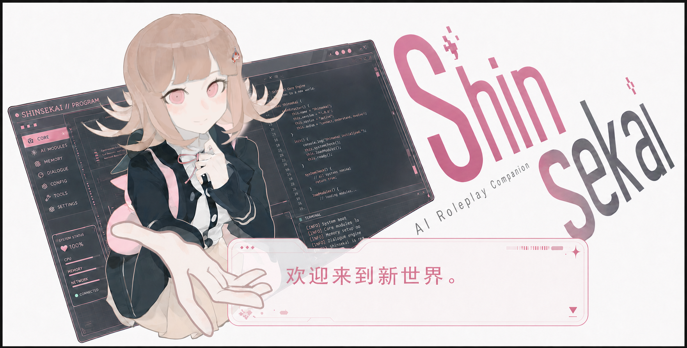
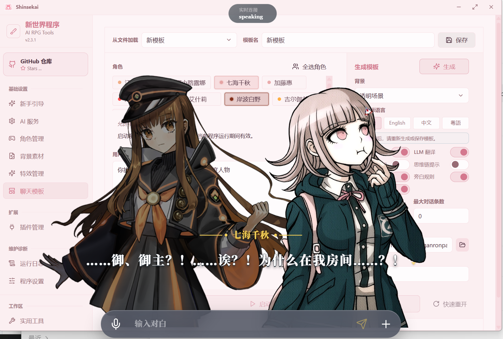

<p align="center">
  
</p>

[中文版](https://github.com/RachelForster/Shinsekai/blob/main/README.md) | [English](https://github.com/RachelForster/Shinsekai/blob/main/docs/README_EN.md)

# Shinsekai

An open-source desktop companion and interactive performance platform for **visual-novel / otome / story-driven RPG** play: let large language models drive character dialogue and story staging with **multi-format visuals (static/animated sprites, MMD, Live2D)**, **outfit groups and emotion sync**, **speech synthesis and lip-sync**, **long-term memory and knowledge retrieval**, **real-time screen perception**, a **built-in desktop agent**, and **plugin / MCP extensions**—managed centrally in the React / Tauri Settings app while the chat stage stays focused on immersion.

---

## Why Shinsekai

- **End-to-end character staging**: chat templates, single-timeline sessions, sprites / 3D & 2D models, outfit groups, mood commands, BGM / CG / sound effects, and TTS / ASR work together in one pipeline.
- **Flexible stage & desktop companion modes**: the React / Tauri **Settings** app manages APIs, characters, stories, and plugins; the **chat stage** focuses on dialogue and presentation, with **LAN mobile QR companion** support and a draggable, edge-docking **circular mini-avatar mode** (with global input shortcut support).
- **Static, transparent video, and 3D / 2D avatars**: supports images, **MP4 / WebM** transparent animated sprites, built-in **MMD (PMX)** models with auto breathing, breeze, gaze, and VPD / VMD motions, and experimental **Live2D** support—plus **lip-sync & speaking blinks** and **outfit groups with story-driven auto-switching**.
- **AI sprite generation & matting studio**: built-in LLM prompt planning, T2I generation, optional **MiniMax H3** image-to-video (22-frame directional transitions and transparent animated sprites), and **ToonOut / ISNet** matting.
- **Structured long-term memory & relationships**: powered by a local **SQLite + FTS5 + ONNX** hybrid engine featuring **Ebbinghaus retention decay** (permanent canon facts vs. fading/re-awakened memories), **per-save memory isolation** (isolated / shared / inherit-readonly), a built-in **self-persona**, **character relationship graphs**, and a separate **knowledge base (RAG)**.
- **Screen-aware companion & desktop assistant**: **real-time screen sharing + local RapidOCR** adapts proactive speaking cadence to story media, video calls, combat, reading, and idle scenes; the built-in **desktop agent (Pi runtime)** helps create characters, generate sprites, prepare character voices, diagnose issues, and scaffold plugins.
- **Extensible models, voice & ecosystem**: connect mainstream LLMs and OpenAI-compatible endpoints, **GPT-SoVITS / Genie TTS / CosyVoice**, **Vosk / Whisper**, and **ComfyUI**; customize chat skins with the **visual theme customizer**, import **100+ character packs**, or extend via the **plugin SDK** and **MCP (SSE / stdio)**.
- **Local-first data**: defaults live under **`data/`** (`api.yaml`, `system_config.yaml`, `history.db`, characters)—easy to back up or fork; start from source or a [release bundle](https://github.com/RachelForster/Shinsekai/releases).

---

## Preview



[](https://www.bilibili.com/video/BV1V4H7z5Ez7/)
[](https://www.bilibili.com/video/BV1Hp4y1c7TU/?share_source=copy_web&vd_source=4641a345db4563ba087d0ed0ba8bdf85)

**Walkthrough (Chinese audio/UI):** [API setup and importing a character pack](https://www.bilibili.com/video/BV1V4H7z5Ez7/)

---

## Feature snapshot

| Area | What you get |
|------|----------------|
| **Characters, relations & self-persona** | Create / import-export character packs (`.char`); AI-assisted bios, descriptions, and translation; visual **character relationship graphs** with affinity (-10 to +10) injected into dialogue context; built-in **self-persona** for global player identity. |
| **Sprites, outfits & dynamic models** | Images, MP4 / WebM transparent video, **MMD (PMX + VPD/VMD)**, and experimental **Live2D**; unified full / half / close-up framing; **outfit groups** (smart auto-grouping, manual switch/lock, story auto-switching); **lip-sync & speaking blinks**; smooth crossfade fallback without transition clips. |
| **AI sprite studio** | Centered workspace: LLM prompt & Chinese tag planning, reference-preserving T2I, optional **MiniMax H3** frame picking / transparent animation / 22-frame directional transitions (with chat-history recommendations) and ToonOut / ISNet matting. |
| **Stage, replay & mini avatar** | **Single-timeline conversations**, non-destructive context compaction, and 4-in-1 revert cascade; multi-select history **stage replay** (with optional missing-voice completion), **copy / PNG screenshot / video recording**; **circular mini-avatar widget** and **LAN mobile QR access**. |
| **Long-term memory & knowledge** | Local **SQLite + FTS5 + ONNX** hybrid engine (zero PyTorch memory dependency); canon facts & Ebbinghaus retention decay, 3 save-isolation modes, and TXT/JSON history extraction; separate **knowledge manager** with per-character bindings. |
| **Screen perception & story mode** | **Screen sharing + local RapidOCR** (subtitles / full screen / region) and shared-audio detection with scene-adaptive thresholds & cooldowns, plus game/plugin ingest; built-in **AI story creator & player**. |
| **Voice (TTS / ASR)** | **TTS**: GPT-SoVITS, Genie TTS, CosyVoice, etc., with optional voice archiving, per-sprite line audio fallback, and `characters.voice.prepare` automated voice pipeline; **ASR**: Vosk / Whisper with F8 hold-to-talk. |
| **LLM, desktop agent & MCP** | Mainstream LLMs and OpenAI-compatible endpoints; **desktop agent** (Pi runtime) with on-demand skills for character creation, diagnostics, and plugin development; built-in / plugin `@tool` and **MCP (SSE / stdio)**. |
| **Image gen (T2I) & themes** | **ComfyUI** integration (with connection diagnostics) and T2I plugins; built-in skins, **visual theme customizer** with live preview, and dedicated BGM / SFX / CG management. |
| **Plugin system** | `data/config/plugins.yaml` manifest and graphical **Plugin Manager** ([Shinsekai-Plugin-Registry](https://github.com/RachelForster/Shinsekai-Plugin-Registry)); extend LLM / TTS / ASR / T2I adapters, tools, Settings, chat workspace, and stage entrypoints. |

---

## Quick start (~5 minutes)

### 1. Get the app

**From source:**

```bash
git clone https://github.com/RachelForster/Shinsekai
cd Shinsekai
```

**Bundle:** download and extract from [Releases](https://github.com/RachelForster/Shinsekai/releases) (`install.bat` / `start-react.bat` included).

### 2. Install dependencies

Bundle users: run `install.bat` (Windows) or `install.command` (macOS).

Developers (Python 3.10 recommended):

```bash
conda create -n shinsekai python=3.10
conda activate shinsekai
pip install -r requirements.txt
```

Linux source users may also run `./scripts/install-linux.sh`. If a Python 3.10 non-`base` conda environment is active, the script installs dependencies into that environment; otherwise it prefers `uv` to create `.venv`, and falls back to a system `python3.10`.

### 3. Open Settings

Bundle: `start-react.bat`. From source, use the platform launch script:

```bash
./start-react.sh
```

Windows and macOS provide `start-react.bat` and `start-react.command`. Source builds require building the React frontend once (`cd frontend && pnpm install && pnpm build`). The retired Qt settings and chat windows are no longer available.

For Tauri desktop development:

```bash
cd frontend
pnpm install
pnpm tauri:dev
```

Before releasing, update the root `VERSION` file and run `pnpm sync:version` inside `frontend/` to sync `package.json`, Tauri Cargo manifests, and `runtime_manifest.json`.

### 4. First conversation

1. Open **API settings**, configure your LLM (e.g. DeepSeek or any OpenAI-compatible endpoint), test the connection, and save.  
2. Under **Character management**, import a pack (example: [nanami.char](https://github.com/RachelForster/Shinsekai/releases/download/v1.0.4/nanami.char); more packs at [Community Resources](https://rachelforster.github.io/Shinsekai/resources.html)), or open the **Assistant** in the bottom-left sidebar to help create one.  
3. Open **Chat template**, select characters (plus optional player character and initial outfits), and generate a template.  
4. Click **Start chat**; send messages on the stage and watch sprites, models, and voices respond.

### Optional: spoken lines

For synthesized dialogue audio, use **API settings → Voice** to download the recommended **GPT-SoVITS** or lightweight **Genie TTS** bundle (or deploy [GPT-SoVITS](https://github.com/RVC-Boss/GPT-SoVITS) manually), or let the desktop assistant prepare character voice references automatically.

---

## Plugin system

List plugins in **`data/config/plugins.yaml`**; source lives under **`plugins/<package>/`**. The host merges **LLM / TTS / ASR / T2I** adapters, **tools**, and contributions to **Settings**, the **tools area**, the **chat workspace**, and the **chat stage**.

- **UI**: Settings → **Plugins** — enable/disable, discover & download from the index, run `pip install -r requirements.txt` with the same interpreter as the app.  
- **Index:** [Shinsekai-Plugin-Registry](https://github.com/RachelForster/Shinsekai-Plugin-Registry)  
- **Scaffold:** `python -m sdk.cli create --package your_plugin_name`  
- **Developer guide:** [PLUGIN_DEVELOPER_GUIDE.md](PLUGIN_DEVELOPER_GUIDE.md)

Restart the app after changing the manifest so plugins reload.

---

## MCP (Model Context Protocol)

Expose [MCP](https://modelcontextprotocol.io/) servers to the **in-process LLM tool list**. Supported transports include **SSE** and **stdio**.

1. Install: `pip install mcp`  
2. Configure **`data/config/mcp.yaml`**, or use Settings → **Plugins** → **MCP** for a visual editor.  
3. **Save & apply** reconnects servers and registers remote tools for the current process (use a name **prefix** per server to avoid clashes).

Independent of the plugin system: you can wire external capabilities through YAML alone—no `PluginBase` required.

---

## Docs & links

| Topic | Link |
|-------|------|
| Chinese README | [README.md](https://github.com/RachelForster/Shinsekai/blob/main/README.md) |
| Changelog & latest release notes | [CHANGELOG.md](../CHANGELOG.md) · [2.7.0 Release notes](releases/2.7.0.md) |
| GUI user guide (Chinese, non-technical) | [GUI_USER_GUIDE_zh-CN.md](GUI_USER_GUIDE_zh-CN.md) |
| Chat UI theme guide (Chinese) | [CHAT_UI_THEME_GUIDE_zh-CN.md](CHAT_UI_THEME_GUIDE_zh-CN.md) |
| Plugin developer guide | [PLUGIN_DEVELOPER_GUIDE.md](PLUGIN_DEVELOPER_GUIDE.md) |
| Repository | [github.com/RachelForster/Shinsekai](https://github.com/RachelForster/Shinsekai) |

Issues and PRs are welcome. If you redistribute character or voice assets, follow each author’s license.

---

## License Notice

Shinsekai is a source-available project. You may inspect the source code, build it locally for personal use, and maintain public forks for discussion and contribution. Redistribution, release builds, installer packages, app store distribution, and commercial use are not permitted without written permission. See [LICENSE](../LICENSE).
