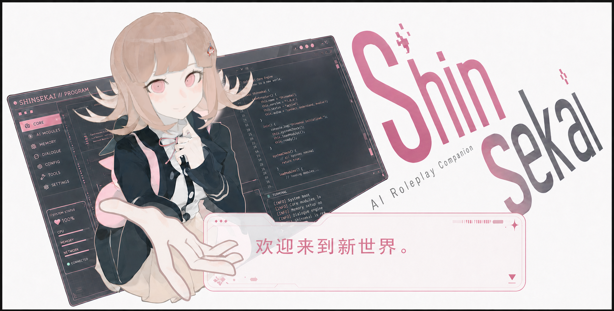
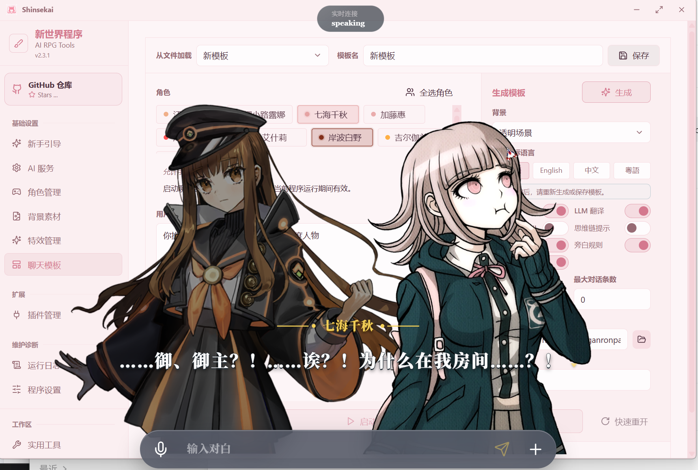

<p align="center">
  
</p>

[English](../README.md) | [简体中文](README_zh-CN.md)

# 新世界（Shinsekai）

面向 **Galgame / 乙女 / 剧情向 RPG** 的公开源码桌面伙伴与交互演出平台：由大语言模型驱动角色对白与剧情演出，结合 **多形态形象（静态 / 动态立绘、MMD、Live2D）**、**服装分组与情绪联动**、**本地语音克隆、语音合成与口型同步**、**长期记忆与资料检索**、**实时屏幕感知**、**桌面智能助手** 与 **插件 / MCP 扩展**——全面支持 **简体中文 / English / 日本語** 全栈三语，在统一的 Material 3 React / Tauri 设置中心集中管理一切，让聊天舞台专注沉浸演出。

> [!TIP]
> **寻找手机版？** 欢迎关注社区开发者 [@Asriel-cute](https://github.com/Asriel-cute) 维护的 Android 移植版 **[Shinsekai-Android](https://github.com/Asriel-cute/Shinsekai-Android)** —— 基于 **Kotlin 与 Jetpack Compose** 打造，支持 AI 角色对话与语音合成。手机版的最新进展、安装包与相关问题反馈请前往该仓库查看。

---

## 核心亮点

- **开箱即用多平台 Portable 绿色整合包**：下载解压并填写大模型 API Key 即可启动，已预置内置 Python 运行环境、**Qwen3-TTS 0.6B GGUF** 本地语音克隆（默认开启且配音语种 `auto` 自适应）、**Sherpa-ONNX** 双阶段流式语音识别、**Qwen3-VL-2B GGUF + RapidOCR** 本地屏幕感知、ONNX 记忆模型与官方 **Pi Agent** 助手运行时（[魔搭 ModelScope](https://www.modelscope.cn/models/twillzxy/shinsekai-portable) · [Hugging Face](https://huggingface.co/RachelForster/shinsekai-portable)）。
- **零门槛上手、全链路演出**：内置 **5 步新手引导** 快速配好模型与语音；通过可插拔 XML 对白与舞台演出协议，随对话自动切换 **背景与 BGM**、弹出 **分支选项与好感度实时变化**、触发 **独立音效与画面特效**、自适应 **全屏与宽屏视野**，接入 **ComfyUI** 后还可在剧情名场面 **现场绘制专属 CG**。
- **实时陪玩、陪看与多形态桌面伙伴**：支持 **实时屏幕感知与本地 RapidOCR**，打游戏看懂战局、追番刷视频同步吐槽，并自适应视频通话、阅读、待机等 7 类场景节奏；支持 **局域网手机扫码伴聊**，也可一键切换为可拖动贴边的 **圆形小图标桌面挂件（小桌宠）**，支持全局快捷键唤起输入。
- **静态、透明视频与 3D / 2D 动态形象**：除图片与 **MP4 / WebM** 透明动态立绘外，内置 **MMD（PMX）** 模型与自动呼吸、微风、视线及 VPD / VMD 动作支持，并提供实验性 **Live2D** 接入；支持 **口型同步与说话眨眼**、**多套服装分组与自动随剧情换装**。
- **单图全套立绘与智能加工**：内置 LLM 提示词规划、T2I 生图、可选 **MiniMax H3** 图生视频（单图生成全套喜怒哀乐立绘、22 帧单向过渡与透明动态立绘）以及 **ToonOut / ISNet** 自动抠图。
- **AI 一句话造角色 & 一键生成分支剧本**：通过 **桌面智能助手（Pi 运行时）** 一句话描述即可查资料、写人设、找图/生图并自动准备角色语音；内置 **AI 剧情模式**，给一句梗概即可铺出可视化 **分支节点画布**，支持多角色同台飙戏与切换视角。
- **剧情回放、视频录制与离线可游玩导出**：可将历史对话一键 **复制文本**、生成 **PNG 长截图**、在原舞台 **逐句剧情回放**（可选补全语音）、实时 **录制 MP4 / WebM 视频**，或 **导出离线可游玩的独立视觉小说整合包**。
- **走出剧本的日常助手与托盘提醒**：桌面助手支持联网查攻略、本地读写文档与整理文件夹、将攻略笔记存入资料库；支持 **系统托盘常驻与开机自启**，定好闹钟日程后，到点会弹出角色卡片并用 **角色语音提醒**。
- **可控的长期记忆、世界书与人物关系**：基于本地 **SQLite + FTS5 + ONNX** 混合检索引擎，支持 **艾宾浩斯遗忘曲线**（固有约定永不遗忘、动态记忆衰减与唤醒）、**按存档隔离记忆**、**可自由重命名的内置玩家「自设」**、**人物关系图谱** 以及独立导入原著 / 设定集的 **角色资料库（RAG）**。
- **皮肤、三语与插件生态**：支持 **中 / 英 / 日三语界面与提示词模板**、内置 **5 套 Galgame 聊天皮肤**（含可视化主题编辑器）、海量社区角色包、**Qwen3-TTS / GPT-SoVITS / Genie TTS / CosyVoice**、**Sherpa-ONNX / Vosk / Whisper**、**插件 SDK** 与 **MCP（SSE / stdio）**，数据全部本地存储在 `data/`，方便备份与本地定制。

---

## 效果预览



[](https://www.bilibili.com/video/BV1V4H7z5Ez7/)
[](https://www.bilibili.com/video/BV1Hp4y1c7TU/?share_source=copy_web&vd_source=4641a345db4563ba087d0ed0ba8bdf85)

**教程：** [配置 API 与导入角色包](https://www.bilibili.com/video/BV1V4H7z5Ez7/)

---

## 核心能力一览

| 模块 | 说明 |
|------|------|
| **新手引导、三语与工作台** | **5 步新手向导**（API / 插件 / 角色 / 背景）快速完成初始化；支持 **简中 / English / 日本語** 界面与提示词模板；Material 3 React / Tauri 设置中心，桌面端支持 **最小化驻留托盘**、开机自启与 **定时日程语音提醒**。 |
| **角色、关系与自设** | 创建 / 导入导出角色包（`.char`），AI 辅助生成设定、简介与翻译，也可由助手一句话自动创建角色；可视化 **人物关系图谱** 与好感度（-10 ~ 10）注入对话；内置全局 **「自设」**（按不可变 ID 识别，支持直接重命名并同步更新人设提示词）。 |
| **立绘、服装与动态模型** | 支持图片、MP4 / WebM 透明视频、**MMD（PMX + VPD/VMD）** 与实验性 **Live2D**；统一全身 / 半身 / 特写取景；**服装分组**（一键智能归组、手动切换 / 锁定、随剧情自动换装）；**口型同步与说话眨眼**；无过渡视频时自动淡入淡出。 |
| **立绘智能生成** | 独立居中工作区：LLM 规划提示词与中文标签、参考图保持取景与比例（单图生成多表情立绘）、可选 **MiniMax H3** 静态选帧 / 透明动态 / 22 帧单向过渡（支持聊天记录推荐）与 ToonOut / ISNet 抠图。 |
| **Galgame 舞台、回放与导出** | 可插拔 XML 对白协议驱动，随对话自动切换 **背景 / BGM / 独立音效与特效**，弹出 **分支选项与好感度变化**，支持全屏/宽屏对话框自适应与 **ComfyUI 现场生成 CG**；单时间线非破坏性压缩与 4 合 1 回溯级联；多选历史 **舞台剧情回放**（可选补全语音）、**复制 / 长截图 / 导出 MP4·WebM 视频 / 导出离线可游玩 VN 包**；**小图标桌宠挂件** 与 **手机扫码连接**。 |
| **AI 剧本与分支画布** | 选定人物、背景与创作梗概一键生成剧本，内置 **可视化分支节点画布**（支持节点连线编辑与 LLM 辅助修改），支持 **多角色同台演绎**、确定性路径校验与版本化保存。 |
| **长期记忆与世界书资料** | 本地 **SQLite + FTS5 + ONNX** 混合引擎（零 PyTorch 重依赖）；支持固有约定与艾宾浩斯记忆衰减、3 种存档隔离模式与文本 / JSON 历史提取；独立 **资料管理** 支持导入原著 / 世界书 TXT 并按角色绑定检索。 |
| **实时感知与日常助手** | **屏幕共享 + 本地 RapidOCR**（字幕 / 全屏 / 框选，内置 `Qwen3-VL-2B GGUF + llama.cpp`）与共享音频检测，支持 **游戏陪玩、追番吐槽、视频通话** 等 7 类场景自适应发言节奏；内置 **桌面智能助手（Pi 运行时）**，支持联网查攻略、读写本地文件、整理目录、管理人物与插件。 |
| **语音（TTS / ASR）** | **TTS**：内置开箱即用 **Qwen3-TTS 0.6B GGUF** 本地语音克隆（支持 `auto` 自动语种），并支持 GPT-SoVITS、Genie TTS、CosyVoice 等，支持语音存档与立绘音频回退，提供 `characters.voice.prepare` 自动化语音准备流程；**ASR**：默认 **Sherpa-ONNX** 双阶段流式识别（Zipformer + SenseVoiceSmall），兼容 Vosk / Whisper 与 F8 按住说话。 |
| **主题、插件与 MCP** | 内置 **5 套 Galgame 聊天皮肤** 与 **可视化主题编辑器**；支持 **ComfyUI** 与 T2I 插件；通过 `data/config/plugins.yaml` 与 **插件市场**（[Shinsekai-Plugin-Registry](https://github.com/RachelForster/Shinsekai-Plugin-Registry)）扩展适配器与页面；支持 **MCP（SSE / stdio）** 接入外部工具。 |

---

## 快速开始（约 5 分钟）

### 1. 获取程序

#### 方式一：绿色免安装整合包（Portable，推荐开箱即用）

如果你希望下载解压后填上 API Key 就立刻使用（无需自己装 Python 或逐个下载本地模型），推荐直接下载多平台 **Portable 绿色整合包**：

- **魔搭 ModelScope（国内高速镜像）**：[twillzxy/shinsekai-portable](https://www.modelscope.cn/models/twillzxy/shinsekai-portable)
- **Hugging Face（海外推荐）**：[RachelForster/shinsekai-portable](https://huggingface.co/RachelForster/shinsekai-portable)

**整合包已预置内容：**

- **内置独立 Python 运行环境**（`runtime/`，无需系统安装 Python）与默认 **ISNet** 立绘抠图
- **本地语音克隆**：`Qwen3-TTS-12Hz-0.6B-Base`（`Q8_0` GGUF，复用内置 `llama.cpp`），默认启用，配音语种默认为 `auto`（自动跟随角色参考音频的语种）
- **本地流式语音识别**：**Sherpa-ONNX** 双阶段语音识别（流式 Zipformer 实时出字 + SenseVoiceSmall 中/英/日/粤/韩停顿秒修）
- **本地实时屏幕感知**：`Qwen3-VL-2B-Instruct`（`Q4_K_M` GGUF）+ `llama.cpp` + **RapidOCR** 本地文字识别（默认开启，零 PyTorch 开箱即用）
- **本地长期记忆向量模型**：ONNX 嵌入模型（`data/cache/huggingface/`）
- **官方桌面智能助手运行时**：预装 **Pi Agent**（`data/agent/runtimes/pi/`）
- **完全便携隔离**：内置 `.shinsekai-portable` 标记，所有配置、存档、记忆与模型都保存在解压目录的 `data/` 下，不与本机其他安装版本冲突

**支持平台与启动方式：**

| 平台 | 归档格式 | 启动方式 | 注意事项 |
|---|---|---|---|
| `windows-x64` | `.zip` | 双击根目录 `shinsekai.exe` | 建议解压到纯英文路径，如 `D:\Shinsekai`（避免桌面或含中文/日文路径） |
| `windows-arm64` | `.zip` | 双击根目录 `shinsekai.exe` | 因上游轮子限制，默认不包含 `Sherpa-ONNX` 与 `RapidOCR` |
| `macos-arm64` | `.tar.gz` | 打开 `Shinsekai.app` | 内含 `Shinsekai.app` 与同级 `data/`；若首次打开提示“已损坏”或无法验证开发者，先在当前目录终端运行 `xattr -cr Shinsekai.app` 再双击启动 |
| `linux-x64` | `.tar.gz` | 终端运行 `./shinsekai` | 如无执行权限先运行 `chmod +x shinsekai` |
| `linux-arm64` | `.tar.gz` | 终端运行 `./shinsekai` | 如无执行权限先运行 `chmod +x shinsekai` |

> 解压到纯英文路径并启动后，只需进入 **API 设定** 填写大模型 API Key 即可立即开始对话、体验本地配音克隆、实时屏幕感知与 Pi Agent 助手。

#### 方式二：标准安装包

也可从 [GitHub Releases](https://github.com/RachelForster/Shinsekai/releases) 或 [项目主页](https://rachelforster.github.io/Shinsekai/) 下载对应系统的标准安装包（Windows `.msi` / `.exe`、macOS `.dmg`、Linux `.AppImage` / `.deb`）。

> **macOS 首次运行**：如果双击提示「无法验证开发者」，请右键（或 Ctrl+点击）文件 → **打开**，在弹出的对话框中再次点 **打开** 即可。或者前往 **系统设置 → 隐私与安全性** 中允许。

#### 方式三：源码运行

```bash
git clone https://github.com/RachelForster/Shinsekai
cd Shinsekai
```

**源码脚本入口：**

| 平台 | 安装 | 启动（React 网页端） |
|------|------|------|
| Windows | 双击 `scripts\install.bat` | 双击 `scripts\start.bat`（或 `scripts\start-tauri.bat`） |
| macOS | 双击 `scripts/install.command` | 双击 `scripts/start.command` |
| Linux | `./scripts/install-linux.sh` | `./scripts/start.sh` |

#### 手机版（Android 社区移植）

如需在 Android 手机上直接体验，可前往社区移植项目 **[Asriel-cute/Shinsekai-Android](https://github.com/Asriel-cute/Shinsekai-Android)**（由 [@Asriel-cute](https://github.com/Asriel-cute) 维护，基于 Kotlin 与 Jetpack Compose，支持 AI 角色对话与语音合成）。若希望连接桌面端实时互动，也可使用桌面版内置的「局域网手机扫码伴聊」功能。

### 2. 安装依赖（源码用户）

**开发者** 使用项目标准 conda 环境 `shinsekai`：

```bash
conda env create -f environment.yml
conda activate shinsekai
```

也可以手动创建同名环境：

```bash
conda create -n shinsekai python=3.10
conda activate shinsekai
pip install -r requirements.txt
```

Linux 源码用户也可以运行 `./scripts/install-linux.sh`。如果已激活 Python 3.10 的非 `base` conda 环境，脚本会直接在当前环境安装依赖；否则会优先用 `uv` 创建 `.venv`，没有 `uv` 时需要系统提供 `python3.10`。

### 3. 启动 React 设置中心

安装完成后，源码用户优先使用平台启动脚本：

| 平台 | 启动方式 |
|------|----------|
| Windows | 双击 `scripts\start.bat` |
| macOS | 双击 `scripts/start.command` |
| Linux | 运行 `./scripts/start.sh` |

`scripts/start.*` 会启动本地 Python HTTP bridge，托管 React 设置中心，并自动打开浏览器。React 设置中心用于管理 API、角色、背景、特效、聊天模板、小工具、插件和 MCP。

源码用户如果没有运行安装脚本，需要先安装前端依赖并构建 React 前端：

```bash
cd frontend
pnpm install
pnpm build
cd ..
```

源码仓库不再提交 `frontend/dist`。`scripts/start.*` 发现构建产物不存在时会提示手动运行 `cd frontend && pnpm install && pnpm build`；需要自动构建时可显式传入 `--build-if-missing` 或 `--build-if-stale`。正式桌面安装包会在 release 构建流程中生成并内置前端资源。Qt 设置页和 Qt 聊天窗已退出，不再提供 Python UI 兼容入口。

### Tauri 桌面端开发

需要调试正式桌面壳、窗口控制、小图标模式或官方 updater 时，在 `frontend/` 下启动 Tauri dev：

```bash
cd frontend
pnpm install
pnpm tauri:dev
```

`pnpm tauri:dev` 会先执行 `pnpm build` 和 `pnpm prepare:tauri-resources`，再运行 `tauri dev`。如果手动拆开执行，请使用完整顺序：

```bash
cd frontend
pnpm build
pnpm prepare:tauri-resources
pnpm tauri dev
```

桌面 dev 模式会被识别为 Tauri 桌面环境：更新按钮走官方 Tauri updater；源码更新入口只保留给非 Tauri 的浏览器/源码模式。

构建本地桌面安装包或做 release dry run 时：

```bash
cd frontend
pnpm install
pnpm build
pnpm prepare:tauri-resources
pnpm tauri build
```

正式 release 构建需要设置 updater 签名私钥环境变量 `TAURI_SIGNING_PRIVATE_KEY`；如果私钥设置了密码，还需要 `TAURI_SIGNING_PRIVATE_KEY_PASSWORD`。本地只想验证打包流程且不生成 updater artifacts 时，可使用 Tauri CLI 的 `--config` 覆盖关闭 `bundle.createUpdaterArtifacts`。

### 版本号同步

发布前只需要修改根目录 `VERSION`，然后运行版本同步脚本：

```bash
cd frontend
pnpm sync:version
```

脚本会把 `VERSION` 同步到 `frontend/package.json`、`frontend/src-tauri/Cargo.toml`、`frontend/src-tauri/Cargo.lock` 中的 `shinsekai-desktop` 条目、`frontend/src-tauri/runtime_manifest.json`，以及已生成的 `frontend/src-tauri/resources/VERSION`。不要手动全局替换版本号，避免误改依赖版本。

### 4. 第一次对话

1. 在 **API 设定** 中填写 LLM（例如 DeepSeek / OpenAI 兼容端点），保存并点击连通检测确认可用。  
2. 在 **角色管理** 导入角色包（示例：[nanami.char](https://github.com/RachelForster/Shinsekai/releases/download/v1.0.4/nanami.char)；更多角色包见 [社区资源](https://rachelforster.github.io/Shinsekai/resources.html)），也可直接在左下角打开 **助手** 请它协助创建或配置角色。  
3. 打开 **聊天模板**，勾选角色（可选设置主控人物与服装组）并生成模板。  
4. **新建或启动聊天**，即可在舞台中发送消息、体验立绘 / 模型联动与语音演出。

### 可选：让角色开口说话

Portable 整合包已预置 **Qwen3-TTS 0.6B GGUF** 本地语音克隆并默认启用（`auto` 自动识别参考音语种）。如需音色更拟真的专用引擎，可在 **API 设定 → 语音模块** 一键下载推荐的 **GPT-SoVITS** 或轻量 **Genie TTS** 整合包（也可自行部署 [GPT-SoVITS](https://github.com/RVC-Boss/GPT-SoVITS)），或借助桌面智能助手的自动语音准备流程为角色匹配/制备参考声音。

---

## 配置 LLM（简要）

1. 顶部进入 **AI 服务设置（API 设定）**。  
2. 选择服务商，填写 **模型 ID**、**API Key**、**基础网址**（部分服务商会自动填充默认地址）。  
3. 保存后回到聊天流程即可使用；**视觉理解** 默认跟随当前 LLM 服务商，也可单独切换。

---

## 插件系统

用 **`data/config/plugins.yaml`** 登记插件；源码放在 **`plugins/<包名>/`**。宿主会合并 **LLM / TTS / ASR / T2I** 适配器、**工具**，以及 **Settings / 工具箱 / 聊天工作区 / 聊天舞台** 等扩展入口。

- **图形界面**：Settings → **插件**：启用/禁用、从索引发现与下载、`pip install` 依赖（与当前解释器一致）。  
- **索引仓库**：[Shinsekai-Plugin-Registry](https://github.com/RachelForster/Shinsekai-Plugin-Registry)  
- **脚手架**：`python -m sdk.cli create --package your_plugin_name`  
- **设计说明**（英文）：[PLUGIN_DEVELOPER_GUIDE.md](PLUGIN_DEVELOPER_GUIDE.md)

修改清单后请 **重启应用** 以加载插件。

---

## MCP（模型上下文协议）

将 [MCP](https://modelcontextprotocol.io/) 服务接入 **本进程 LLM 工具列表**：支持 **SSE** 与 **stdio** 等传输方式。

1. 安装：`pip install mcp`  
2. 配置：**`data/config/mcp.yaml`**，或在 Settings → **插件** → **MCP** 子页可视化编辑。  
3. **保存并应用** 会重连服务并把远端工具注册到当前会话（可用前缀避免工具名冲突）。

与插件系统独立：不写插件也能通过 YAML 接外部能力。

---

## 文档与链接

| 内容 | 链接 |
|------|------|
| **项目主页（GitHub Pages）** | [rachelforster.github.io/Shinsekai](https://rachelforster.github.io/Shinsekai/) |
| **绿色整合包仓库（Portable）** | [魔搭 ModelScope](https://www.modelscope.cn/models/twillzxy/shinsekai-portable) · [Hugging Face](https://huggingface.co/RachelForster/shinsekai-portable) |
| **手机版（Android 社区移植）** | [Asriel-cute/Shinsekai-Android](https://github.com/Asriel-cute/Shinsekai-Android) |
| **English README（默认主页）** | [README.md](../README.md) |
| **更新日志与最新版本说明** | [CHANGELOG.md](../CHANGELOG.md) · [2.7.0 Release notes](releases/2.7.0.md) |
| **图形界面使用指南（新手）** | [GUI_USER_GUIDE_zh-CN.md](GUI_USER_GUIDE_zh-CN.md) |
| 立绘智能生成与 MiniMax H3 接入 | [CHARACTER_SPRITE_GENERATION_zh-CN.md](CHARACTER_SPRITE_GENERATION_zh-CN.md) |
| ComfyUI 连接指南 | [COMFYUI_SETUP_zh-CN.md](COMFYUI_SETUP_zh-CN.md) |
| MMD 与 Live2D 接入指南 | [MMD_INTEGRATION_zh-CN.md](MMD_INTEGRATION_zh-CN.md) · [LIVE2D_INTEGRATION_zh-CN.md](LIVE2D_INTEGRATION_zh-CN.md) |
| 聊天皮肤定义与制作指南 | [CHAT_UI_THEME_GUIDE_zh-CN.md](CHAT_UI_THEME_GUIDE_zh-CN.md) |
| 剧情回放与导出说明 | [CHAT_REPLAY_CUJ_zh-CN.md](CHAT_REPLAY_CUJ_zh-CN.md) |
| 桌面智能助手、托盘提醒与剧情模式 | [AGENT_APP_INTEGRATION_zh-CN.md](AGENT_APP_INTEGRATION_zh-CN.md) · [DESKTOP_TRAY_zh-CN.md](DESKTOP_TRAY_zh-CN.md) · [STORY_MODE_WORKSPACE_zh-CN.md](STORY_MODE_WORKSPACE_zh-CN.md) |
| 插件开发者指南 | [PLUGIN_DEVELOPER_GUIDE.md](PLUGIN_DEVELOPER_GUIDE.md) |
| 本仓库 | [github.com/RachelForster/Shinsekai](https://github.com/RachelForster/Shinsekai) |

## 社区

开发者 QQ 群：928985460

欢迎 Issue / PR；若二次分发角色与语音资源，请遵守对应作者许可。

---

## 许可说明

新世界是公开源码（Source-Available）项目，基于 **PolyForm Strict License 1.0.0** 并附带 **Shinsekai 附加许可与贡献条款**。你可以查看源码、本地构建与修改用于个人非商业自用和学习，也可以在 GitHub 上 fork 用于学习、讨论和提交 PR；未经书面许可，禁止商业使用，也禁止二次发布（包括再分发源码或修改版、发布 Release、安装包、便携包、独立镜像或上架应用商店）。详见 [LICENSE](../LICENSE)。
